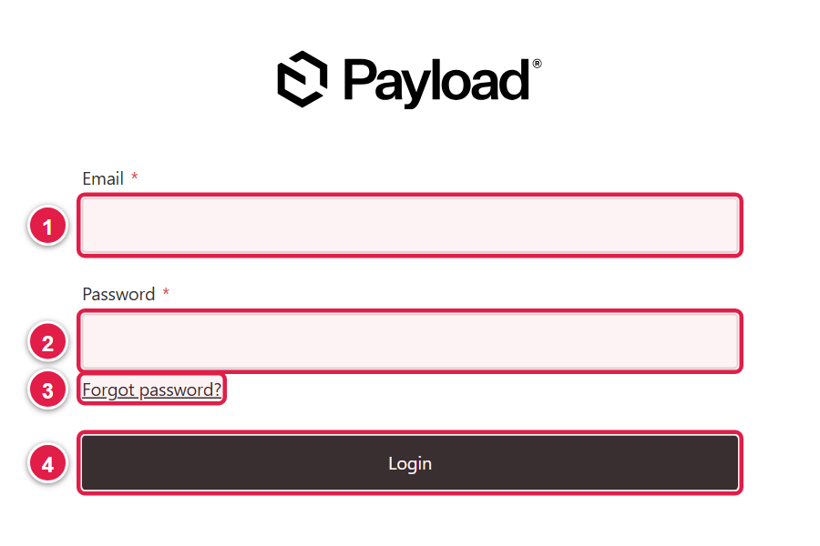
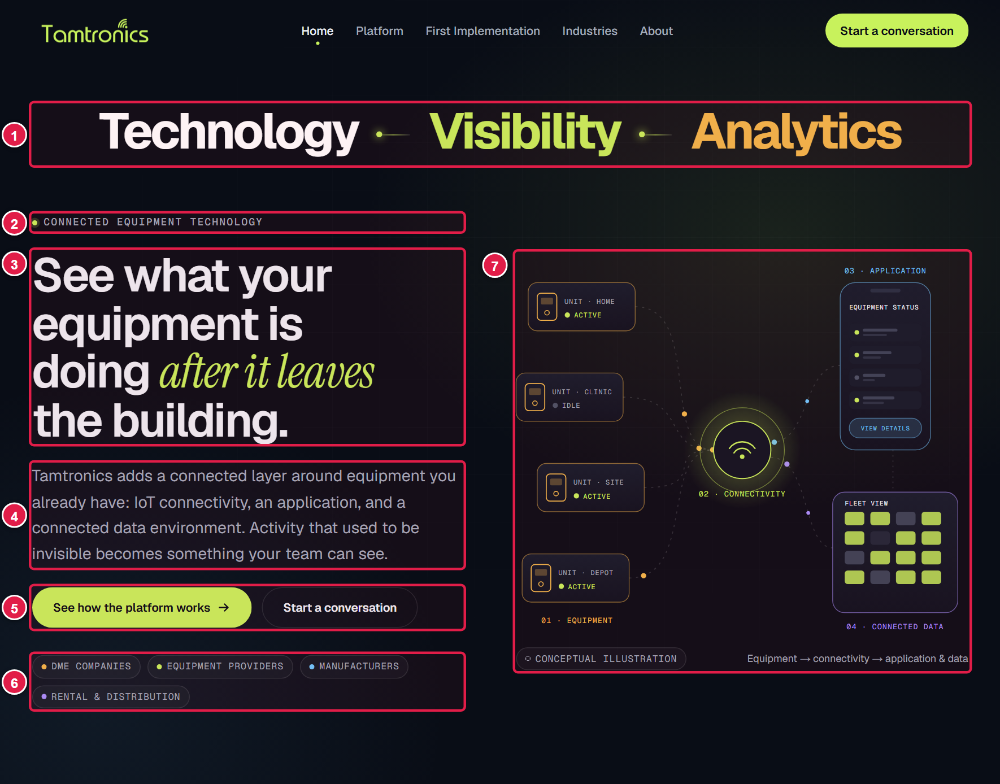
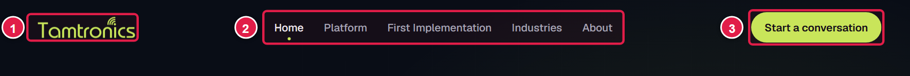
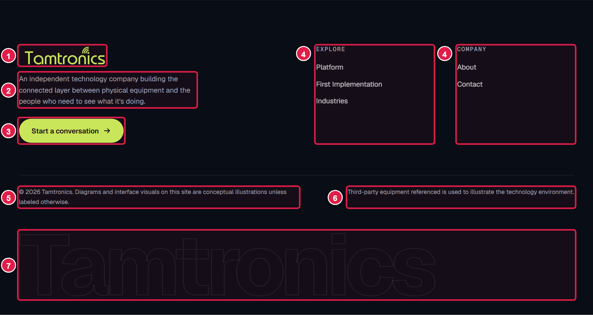
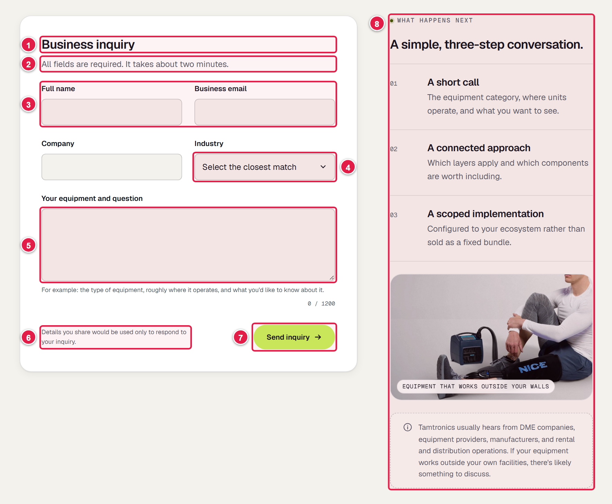

# Tamtronics Website: CMS Admin Panel User Guide

*Version 1.0 · 16 November 2026 · For website administrators and marketing editors*

This guide explains, step by step and in plain language, how to manage the Tamtronics website through its Admin Panel (Payload CMS). It describes only what exists in this website’s CMS. Anything that does not exist is marked **Not Available in Current CMS**.

## Contents

- [1. Introduction to the CMS](#1-introduction-to-the-cms)
- [2. Logging In and Out](#2-logging-in-and-out)
- [3. Dashboard Overview](#3-dashboard-overview)
- [4. Understanding the Admin Panel Navigation](#4-understanding-the-admin-panel-navigation)
- [5. Managing Website Pages](#5-managing-website-pages)
- [6. Editing Page Content and Sections](#6-editing-page-content-and-sections)
- [7. Managing Images and Media](#7-managing-images-and-media)
- [8. Blogs, Blog Categories and Blog Posts](#8-blogs-blog-categories-and-blog-posts)
- [9. Managing SEO Metadata](#9-managing-seo-metadata)
- [10. Managing the Website Header and Navigation](#10-managing-the-website-header-and-navigation)
- [11. Managing the Website Footer](#11-managing-the-website-footer)
- [12. Managing Global Website Settings](#12-managing-global-website-settings)
- [13. Platform Layers, Testimonials, FAQs and Other Content](#13-platform-layers-testimonials-faqs-and-other-content)
- [14. Managing Redirects](#14-managing-redirects)
- [15. Managing the Business Inquiry Form and Enquiries](#15-managing-the-business-inquiry-form-and-enquiries)
- [16. Managing Users and Your Account](#16-managing-users-and-your-account)
- [17. Using the Custom Admin Panel Features](#17-using-the-custom-admin-panel-features)
- [18. Saving, Publishing and Updating Content](#18-saving-publishing-and-updating-content)
- [19. Understanding Drafts and Version History](#19-understanding-drafts-and-version-history)
- [20. Common Errors and Troubleshooting](#20-common-errors-and-troubleshooting)
- [21. Content Management Best Practices](#21-content-management-best-practices)
- [Appendix A: Page Section and Element Field Reference](#appendix-a-page-section-and-element-field-reference)
- [Appendix B: Who Can Do What (Permissions)](#appendix-b-who-can-do-what-permissions)
- [Appendix C: Complete Inventory of Admin Panel Features](#appendix-c-complete-inventory-of-admin-panel-features)
- [Appendix D: Glossary](#appendix-d-glossary)
- [Appendix E: Screenshot Checklist](#appendix-e-screenshot-checklist)
- [Appendix F: About This Guide](#appendix-f-about-this-guide)

---

# 1. Introduction to the CMS

## 1.1 What the CMS is

The Tamtronics website is edited through a **Content Management System (CMS)**. The CMS is a password-protected area of the website, called the **Admin Panel**, where you change the text, images, menus and settings of the website without writing any code. It is built with Payload CMS, and in your browser tab it is titled **“… | Tamtronics CMS”**.

The Admin Panel lives at the website address followed by `/admin`. For example, if the website is `https://tamtronics.com`, the Admin Panel is at `https://tamtronics.com/admin`.

## 1.2 What you can manage

| To change… | Go to… (left menu) |
| --- | --- |
| Text, images, buttons and sections on a page | **Content › Pages** |
| Uploaded pictures (logo, photos, app screenshots) | **Content › Media** |
| Messages sent through the contact form | **Forms › Form Submissions** |
| The contact form’s fields, wording and emails | **Forms › Business Inquiry Form** |
| The top menu, logo and header button | **Site › Header** |
| Footer text, link columns and copyright | **Site › Footer** |
| The text of the four-layer explorer on the Home and Platform pages | **Site › Platform Layers** |
| Site name, public address, default search/social details, favicon, Google Tag Manager | **Site › Site Settings** |
| Forwarding an old web address to a new one | **Settings › Redirects** |
| Who can sign in to the CMS | **Settings › Users** (Admins only) |

## 1.3 What this CMS does not have

This guide only describes what exists. The following features are **not available in the current CMS**. Please do not look for them.

| Feature | Status |
| --- | --- |
| Blog posts, blog categories, authors | **Not Available in Current CMS** |
| Testimonials | **Not Available in Current CMS** (no separate module) |
| FAQs | **Not Available in Current CMS** (no separate module; see Chapter 13 for the closest alternatives) |
| Importing a Word (DOCX) document into a page | **Not Available in Current CMS** |
| Importing or exporting content (CSV, JSON) | **Not Available in Current CMS** |
| A separate “Navigation” or “Menus” module | **Not Available in Current CMS** (menus are edited inside Header and Footer) |
| Live Preview (editing beside a live view) | **Not Available in Current CMS** (a **Preview** button on pages is available instead) |
| Scheduling a page to publish later | **Not Available in Current CMS** |
| Version history for Header, Footer, Site Settings, Media, Users or Forms | **Not Available in Current CMS** (version history exists for **Pages** only) |
| Several languages | **Not Available in Current CMS** |
| A recycle bin to recover deleted items | **Not Available in Current CMS** (deleting is permanent) |
| Changing colours, fonts or the visual design | **Not Available in Current CMS** (a developer changes the design) |
| Editing the text inside the animated diagrams | **Not Available in Current CMS** (a developer changes diagrams; the captions next to them are editable) |
| Website visitor statistics and analytics reports | **Not Available in Current CMS** (see Chapter 12 for the Google Tag Manager field) |

## 1.4 What the CMS does automatically

- The **sitemap** (`/sitemap.xml`) and **robots.txt** files are produced automatically from your pages and settings. There is nothing to edit.
- The **home page** automatically includes a short “Organization” description for search engines, built from **Site Settings**.
- When you publish or save, the website’s page cache is cleared automatically so visitors see the change on their next page load.

## 1.5 User roles

Every person who signs in has one of two roles. Your role decides what you can do.

| Role | Label shown in the CMS | What it allows |
| --- | --- | --- |
| **Admin** | “Admin: everything, including users” | Everything an Editor can do, plus deleting pages, media, form submissions and redirects; adding, removing and changing users; and changing the form’s email notification settings. |
| **Editor** | “Editor: content, media and form submissions” | Creating and editing pages, media, redirects, header, footer, site settings, platform layers and the inquiry form’s fields and messages; managing form submissions (status and notes); editing their own account. **Editors cannot delete content.** |

A full permissions table is in Appendix B.

## 1.6 Custom features and standard features

Most of the Admin Panel is the standard Payload CMS, which behaves the same way in every Payload website. A few things are **custom to this website**. This guide marks them clearly.

| Area | Type |
| --- | --- |
| Login, dashboard, lists, search, filters, drafts, autosave, version history, document locking, account page | Standard Payload CMS |
| The visible **Log out** button in the left menu | **Custom** to this website |
| The **Preview** button on pages, which opens the real website showing your draft, with an **Exit preview** link | **Custom** to this website (the button is standard; the preview page behind it is custom) |
| The page builder: sections and elements such as Hero, Content section, Two-column section, Cards, Usage chart, Walkthrough | **Custom** to this website |
| The headline accent (`*word*` becomes an italic accent) | **Custom** to this website |
| Business Inquiry Form settings and Form Submissions with email delivery status | **Custom** to this website |
| Header, Footer, Platform Layers and Site Settings records | **Custom** to this website |
| Redirects | Standard Payload plugin, configured for this website |
| Two roles (Admin and Editor) | **Custom** to this website |

## 1.7 How a change reaches the live website

Different kinds of content behave differently. Learn this table; it prevents most surprises.

| Content | When you save… | What visitors see |
| --- | --- | --- |
| **Pages** | The CMS saves a **draft** automatically every couple of seconds while you type. | Nothing changes yet. Visitors keep seeing the last published version. |
| **Pages** | You click **Publish changes**. | The live page updates on the next page load. |
| **Header, Footer, Platform Layers, Site Settings, Business Inquiry Form** | You click **Save**. | The change is live immediately. There is no draft step. |
| **Media** | You click **Save** (or upload). | The new or replaced picture is live immediately wherever it is used. |
| **Redirects** | You click **Save**. | The redirect works immediately. |

> **Warning:** Header, Footer, Site Settings and the other “Site” items have **no draft and no undo**. Anything you save there is public at once.

## 1.8 How to read this guide

- **Bold text** is a button, field or menu name exactly as it appears in the CMS.
- **Menu › Item** means: click the menu or group, then the item inside it.
- Boxes marked **Note**, **Tip** and **Warning** highlight important points.
- Real pictures of the screens are included as figures. Where a picture of a signed-in screen is not yet available, you will see a box labelled **Screenshot needed**. Appendix E lists them all.
- Page names and menu items described here are the ones the website was set up with. If your team has changed them, follow the same steps with your own names.

> **Note:** Figures that show the website’s header, footer and pages are pictures of the **public website**, with numbers added to show which CMS field controls each part. They are not pictures of the Admin Panel.

---

# 2. Logging In and Out

## 2.1 What you need

1. The website’s CMS address (the website address plus `/admin`).
2. Your email address and password. An **Admin** creates your account (see Chapter 16). Never share your password.
3. A modern web browser such as Chrome, Edge, Firefox or Safari.

## 2.2 How to log in

1. Open your browser and go to the CMS address, for example `https://tamtronics.com/admin`.
2. The **Login** screen appears (Figure 1). The browser tab reads **Login | Tamtronics CMS**.
3. Click the **Email** box (**1**) and type your email address.
4. Click the **Password** box (**2**) and type your password.
5. Click **Login** (**4**).
6. You arrive at the **Dashboard** (Chapter 3).



*Figure 1. Admin login screen. 1 Email, 2 Password, 3 Forgot password? link, 4 Login button.*

| Number | What it is |
| --- | --- |
| 1 | **Email**: the address your Admin used to create your account. |
| 2 | **Password**: your password. |
| 3 | **Forgot password?**: starts a password reset (section 2.4). |
| 4 | **Login**: signs you in. |

> **Note:** If you type the wrong email or password the CMS says “The email or password provided is incorrect.” Check for typos and try again.

> **Warning:** After **5 wrong attempts** the account is **locked for 10 minutes**. Wait, or ask an Admin to unlock it (section 16.5).

## 2.3 If you see “Create first user”

On a brand-new, empty website the CMS asks for the first account to be created, and that first account automatically becomes an **Admin**. On the live Tamtronics website you should **never** see this. If you do, **do not enter anything**: close the page and tell the developer.

## 2.4 If you forget your password

1. On the Login screen click **Forgot password?** (**3**).
2. Type your email address and submit the form.
3. Check your email for a message containing a reset link. The link works for **one hour**.
4. Click the link. Type a **New Password** and **Confirm Password**, then submit.
5. Log in with the new password.

> **Note:** Reset emails are only sent when the website’s email (SMTP) settings have been set up by the developer. If no reset email arrives, ask an **Admin** to set a new password for you under **Settings › Users** (section 16.4).

## 2.5 Staying signed in and automatic sign-out

A session lasts about **two hours**. If you stop working, the CMS shows a message: “You haven’t been active in a little while and will shortly be automatically logged out for your own security. Would you like to stay logged in?” Click **Stay logged in** to carry on. If you ignore it, you are signed out and the next screen says “You have been logged out due to inactivity.”

> **Warning:** Draft pages are saved automatically, but **Header, Footer and other Site items are not**. Click **Save** before you step away.

## 2.6 How to log out

> **Custom feature:** This website adds a clearly visible **Log out** button to the left menu. Payload’s own small logout icon is also still there.

1. Look at the bottom of the **left menu**.
2. Click the **Log out** button (the button reads **Logging out…** for a moment).
3. You return to the Login screen.

> **Tip:** Always log out on a shared or public computer.

---

# 3. Dashboard Overview

## 3.1 What the Dashboard is

The **Dashboard** is the first screen after you log in. It is a map of everything you can manage. You can return to it at any time by clicking **Dashboard** in the top bar, or the Tamtronics CMS address `/admin`.

> **Screenshot needed (S-01): Dashboard after login.** Sign in as an Admin and capture the whole window at `/admin`. Number the left menu, the four group headings (Content, Forms, Settings, Site), a collection card with its **+** button, and a global card.

## 3.2 What is on the Dashboard

The Dashboard shows one panel (a “widget”) called **Collections**. It lists every area of the CMS, grouped under four headings, in this order:

| Group | Cards inside | Kind of card |
| --- | --- | --- |
| **Content** | **Pages**, **Media** | Lists of records. Each has a **+** button to create a new one. |
| **Forms** | **Form Submissions**, **Business Inquiry Form** | Form Submissions is a list (no **+** button, because submissions only arrive from the website). Business Inquiry Form is a single settings page. |
| **Settings** | **Users**, **Redirects** | Lists of records. **Users** has a **+** button only for Admins. |
| **Site** | **Header**, **Footer**, **Platform Layers**, **Site Settings** | Single settings pages. They open directly; there is no list. |

- Click a **card’s name** to open its list (or, for a single settings page, the page itself).
- Click the **+** button on a list card to create a new record.

> **Note:** There are two kinds of items in the CMS. A **collection** holds many records (for example many pages). A **global** is one single record (for example the one Footer). Collections open as a list. Globals open straight into the form.

## 3.3 What the Dashboard does not show

The Dashboard has **no** visitor statistics, “recent activity”, count of new inquiries or to-do list. To see new inquiries, open **Forms › Form Submissions**.

## 3.4 Rearranging the Dashboard (optional)

The standard Payload dashboard can be personalised. Use the **Dashboard** menu in the top bar and choose **Edit Dashboard** to move or add widgets; **Reset Layout** puts it back. This only changes **your own** view and does not change the website. The only widget this website provides is **Collections**.

> **Screenshot needed (S-02): Dashboard top-bar menu showing Edit Dashboard.** Capture the top bar with the Dashboard menu open.

---

# 4. Understanding the Admin Panel Navigation

## 4.1 The parts of the screen

| Part | Where | What it does |
| --- | --- | --- |
| **Left menu** | Left side | Lists every area, in groups. Click a group heading to fold it open or closed. |
| **Log out button** | Bottom of the left menu | Custom button that signs you out. |
| **Top bar** | Across the top | Shows where you are (a “breadcrumb” such as Pages › Home) and the **Account** icon (a person icon at the top right) that opens your account page. |
| **Main area** | Centre | The list or form you are working in. |

> **Screenshot needed (S-03): Annotated overview of the Admin Panel.** Capture any list screen (for example Pages) with numbers on the left menu, a group heading, the top bar breadcrumb, the Account icon and the main area.

## 4.2 The left menu

The left menu has four groups. The order and names below are exactly what you will see.

| Group | Items |
| --- | --- |
| **Content** | Pages, Media |
| **Forms** | Form Submissions, Business Inquiry Form |
| **Settings** | Users, Redirects |
| **Site** | Header, Footer, Platform Layers, Site Settings |

> **Note:** Editors see the same items as Admins. The difference is what you are allowed to do inside them (Appendix B). For example, only Admins see **Delete** buttons.

## 4.3 Working in a list (collections)

Opening **Pages**, **Media**, **Form Submissions**, **Users** or **Redirects** shows a list. These standard tools appear above or on the list:

| Tool | What it does |
| --- | --- |
| **Create New** | Starts a new record (not shown where you are not allowed to create, for example Form Submissions). |
| **Search box** (it reads “Search by …”) | Finds records by typing. On **Form Submissions** it searches name, email, company and message. |
| **Filters** | Narrows the list, for example only pages that are Drafts, or submissions with Status “New”. Use **Add Filter**; **Clear All** removes them. |
| **Columns** | Chooses which columns the list shows. |
| **Sort** | Click a column heading to sort by it. |
| Row **checkboxes** | Select several records to apply a bulk action that appears above the list (the actions depend on your role). |
| Page controls | Move between pages of results and choose how many to show. |

The columns shown by default are:

| List | Default columns |
| --- | --- |
| **Pages** | Title, Slug, Status, Updated At |
| **Media** | File Name, Alt text, Updated At |
| **Form Submissions** (newest first, 25 per page) | ID, Sender name, Sender email, Company, Status, Created At |
| **Users** | Email, Name, Role |

> **Screenshot needed (S-04): Pages list.** Capture **Content › Pages** with the Search box, Filters, Columns, Create New button and a row highlighted.

## 4.4 Working in a record (the edit screen)

Opening a record shows its form. Common parts:

- The **title** of the record at the top and the **Status** (for pages: Draft, Published or Changed).
- Tabs below the title where a record has them (for example **Page sections** and **SEO** on a page; **Edit**, **Versions** and **API** for records). The **API** tab is for developers; you never need it.
- A sidebar on the right with extra fields (for example **Slug** on pages, **Status** and **Notes** on form submissions).
- Buttons at the top right (**Publish changes**, **Preview**, **Save**, or the **⋯** menu), described in Chapter 18.
- **Last Modified** and **Created** dates.

## 4.5 Rows, lists and drag-and-drop

Many fields are **repeating lists** (for example menu items or buttons) or **block lists** (the page sections). They behave the same everywhere:

1. Click the **Add …** button under the list to add an entry. The button is named for what it adds (for example **Add Menu item**, **Add Button**, **Add Section**).
2. Click a row’s title to fold it open or closed.
3. Drag a row by its **handle** (the grip at the left of the row) to change the order.
4. Click the row’s **⋯** menu for **Move Up**, **Move Down**, **Add Below**, **Duplicate** and **Remove**.

> **Warning:** **Remove** deletes the row immediately from the form. On pages the earlier version can be recovered from version history (Chapter 19). On Header, Footer and other Site items it cannot: leave the page without saving to cancel.

## 4.6 Two people editing at once

If someone else is editing the same record, the CMS shows a **Document locked** notice with the person’s name. A lock expires about **5 minutes** after they stop editing. A **Take over** button lets you take control; use it only after checking with them, because their unsaved work is lost.

## 4.7 Leaving with unsaved changes

If you try to leave a form that has unsaved changes, the CMS warns you: “You have unsaved changes. Save or discard before continuing.” Choose **Leave without saving** to discard, or stay and save.

## 4.8 Your account page

Click the **Account** icon (a person icon at the top right). You can change your **Name** and **Password**, choose the screen colours with **Admin Theme** (Automatic, Light or Dark) and **Language**, and use **Reset Preferences** to restore columns and menu choices to their defaults. You cannot change your own role; only an Admin can. See Chapter 16.

> **Screenshot needed (S-05): Account page.** Capture the Account screen showing Email, Name, Role, Change Password, Admin Theme and Language.


---

# 5. Managing Website Pages

## 5.1 What the Pages area does

**Content › Pages** holds every page of the website. When the site was set up it contained six pages:

| Page (Title) | Slug | Address on the website |
| --- | --- | --- |
| Home | `home` | `/` (the home page) |
| Platform | `platform` | `/platform` |
| First Implementation | `first-implementation` | `/first-implementation` |
| Industries | `industries` | `/industries` |
| About | `about` | `/about` |
| Contact | `contact` | `/contact` |

Each page is made of **sections** you can add, remove and reorder (Chapter 6) plus **SEO** details (Chapter 9). Pages have **drafts, autosave and version history**: this is the only area of the CMS that does.

> **Note:** The slug `home` is special: it is the front page, shown at `/`. Visiting `/home` automatically sends visitors to `/`.

## 5.2 Open the list of pages

1. Click **Content** in the left menu to open the group, then click **Pages**.
2. The list shows **Title**, **Slug**, **Status** and **Updated At** for each page. **Status** is **Draft** or **Published**.
3. Click a page’s **Title** to open it.

> **Screenshot needed (S-06): Pages list with the six pages.** Capture **Content › Pages** showing the Status column.

## 5.3 Create a new page

1. Go to **Content › Pages**.
2. Click **Create New** (top right).
3. Type the **Title**. This is the page’s internal name. It is also the browser-tab title **if you leave the SEO title empty**.
4. In the right-hand sidebar, type the **Slug**. This is the page’s web address.
   - Use **lowercase letters, numbers and hyphens only**. Example: `pricing` becomes `/pricing`; `case-studies` becomes `/case-studies`.
   - No spaces, capitals, slashes or full stops.
   - Every slug must be unique.
   - These names are reserved by the system and cannot be used: `admin`, `api`, `preview`, `assets`, `media`, `sitemap`, `robots`.
5. Open the **Page sections** tab and click **Add Section** to build the page (Chapter 6). A new page can start with a **Hero** followed by one or more **Content sections**.
6. Open the **SEO** tab and fill in the search and social details (Chapter 9).
7. Your work is saved automatically as a **draft**. The **Status** shows **Draft**.
8. Click **Preview** to see it on the real website (section 18.4).
9. When you are happy, click **Publish changes**.
10. Add the page to the header menu and/or footer so visitors can find it (Chapters 10 and 11).
11. Verify: open `https://<your website>/<slug>` in a new browser tab (section 5.8).

> **Note:** A published page that is not linked from the header or footer is still reachable by anyone who knows its address, and search engines can find it unless you tick **Hide from search engines** on the SEO tab.

> **Screenshot needed (S-07): New page form.** Capture **Create New** on Pages showing Title, the Slug field in the sidebar, the **Page sections** and **SEO** tabs, and the **Publish changes** button.

Common mistakes when creating a page:

- Typing a slug with capital letters or spaces. The CMS says “Use lowercase letters, numbers and hyphens only.”
- Using a reserved name. The CMS says “This address is used by the system. Please choose another.”
- Forgetting to click **Publish changes**. The page stays a draft and visitors see a “not found” page.
- Forgetting to add the page to the menu.

## 5.4 Edit an existing page

1. Go to **Content › Pages** and click the page’s **Title**.
2. Make your changes on the **Page sections** or **SEO** tab (Chapters 6 and 9).
3. The CMS **autosaves** a draft about every two seconds. Watch the status area at the top: it shows when it last saved.
4. Click **Preview** to check how it looks (section 18.4).
5. Click **Publish changes** to make the changes live.
6. Verify on the live website (section 5.8).

> **Note:** While you edit a page that is already published, its **Status** changes to **Changed**. That means “the live page is the old version; you have newer unpublished edits.” Visitors still see the old version until you click **Publish changes**.

## 5.5 Duplicate a page

Use this to start a new page from an existing one.

1. Open the page you want to copy.
2. Click the **⋯** menu at the top right and choose **Duplicate**.
3. A copy opens as a **Draft**. Its **Slug** will read like `about - Copy`, which is **not allowed**.
4. Change the **Slug** to a proper new address (lowercase letters, numbers and hyphens) and change the **Title**.
5. Edit the sections, then **Publish changes**.

> **Warning:** Do not publish a duplicate until you have changed its text. Two pages with the same content can harm search results.

## 5.6 Change a page’s address (slug)

> **Warning:** Changing the slug changes the page’s web address. Links that point to the old address (in menus, buttons and other websites) will stop working.

1. Open the page and change the **Slug**.
2. Click **Publish changes**.
3. Update every menu, footer link and button that pointed to the old address (Chapters 6, 10 and 11).
4. Add a **redirect** from the old address to the new page so visitors and search engines are forwarded (Chapter 14).

## 5.7 Unpublish or delete a page

**Unpublish** takes a page off the website but keeps it in the CMS:

1. Open the page, click **⋯**, choose **Unpublish**, and confirm “Confirm unpublish”.
2. Visitors now see a “not found” page. The page remains in the list as a **Draft**.

**Delete** removes the page permanently:

1. Only an **Admin** can delete. Editors do not see the **Delete** option.
2. Open the page, click **⋯**, choose **Delete**, and confirm.

> **Warning:** Deleting is **permanent**. There is no recycle bin and no undo. Unpublish instead if you might want the page back.

> **Warning:** Never delete or unpublish the **Home** page. The website’s front page would show “not found”. Also check that no menu, footer or button still links to a page you remove.

## 5.8 How to verify a change on the live website

1. Open the website in a **new browser tab** (not the CMS tab).
2. Go to the page’s address, for example `/platform`.
3. Press **Ctrl + F5** (Windows) or **Cmd + Shift + R** (Mac) to reload without the browser’s saved copy.
4. Check your change. If you cannot see it, see Chapter 20.

> **Tip:** Publishing clears the website’s page cache automatically, so a published change normally appears on the very next page load.

---

# 6. Editing Page Content and Sections

## 6.1 How a page is built

A page is a stack of **sections**, from top to bottom. Each section can hold **elements** (text, photos, cards and so on).

```
Page
 ├─ Section: Hero
 ├─ Section: Content section
 │    ├─ Element: Usage chart
 │    └─ Element: Cards
 ├─ Section: Two-column section
 │    ├─ Left column:  Text + Photo
 │    └─ Right column: Numbered list
 └─ Section: Call-to-action band
```

Everything is edited on the **Page sections** tab. The tab shows a list headed **Sections**. Add, remove and drag sections to reorder the page.

> **Screenshot needed (S-08): Page sections tab with several sections folded.** Capture the **Page sections** tab of the Home page with sections collapsed so their names show, the **Add Section** button and a row’s drag handle and **⋯** menu.

## 6.2 Open a page’s sections

1. Go to **Content › Pages** and click the page.
2. Make sure the **Page sections** tab is selected.
3. Click a section’s title bar to open or fold it. Use **Collapse All** / **Show All** above the list to fold or unfold everything.

## 6.3 Add, move, duplicate and remove sections

**Add a section**

1. At the bottom of the **Sections** list click **Add Section**.
2. A panel shows the section types. The **Inquiry form** is under an **Interactive** heading.
3. Click the one you want (see section 6.4).
4. Fill in its fields. Required fields are marked with an asterisk (*).
5. Wait for the autosave, then **Preview** and **Publish changes**.

To insert a section **between** two others, use a row’s **⋯ › Add Below**.

**Move a section**

1. Drag the section’s **handle** (the grip at the left of its title bar) up or down, **or**
2. Click its **⋯** menu and choose **Move Up** or **Move Down**.

**Duplicate a section**

1. Click the section’s **⋯** menu.
2. Choose **Duplicate**. A copy appears directly below. Edit the copy.

**Remove a section**

1. Click the section’s **⋯** menu.
2. Choose **Remove**.
3. The section disappears from the form. It leaves the live website only after **Publish changes**. If you removed the wrong one, you can restore an earlier version (Chapter 19).

## 6.4 The section types

| Section (label in the CMS) | What visitors see | Main fields |
| --- | --- | --- |
| **Hero** | The large banner at the top of a page: optional animated words, a small label, a big heading, an intro paragraph, buttons, small audience labels and an optional element on the right (for example a diagram). | **Variant** (Home, Inner page, Inner page compact, Inner page large with visual), **Animated words above the hero** (up to 3), **Breadcrumb label**, **Heading** (required), **Intro paragraph**, **Buttons**, **Audience labels**, **Right-hand side** |
| **Content section** | A band with an optional heading, and any elements underneath. The most common section. | **Background**, **Anchor ID**, **Section heading** (Layout, Small label, Heading, Intro paragraph…), **Contents** |
| **Two-column section** | Two side-by-side columns, each holding elements. | **Background**, **Anchor ID**, **Widths** (Equal, Wider left, Wider right), **Align columns to the top**, **Left column**, **Right column** |
| **Call-to-action band** | A bright strip with a heading, a short text and buttons, usually at the end of a page. | **Heading** (required), **Body**, **Buttons** |
| **Sticky section menu** | A menu that stays under the header and jumps to sections on the same page. | **Label for screen readers**, **Items** (each with a **Label** and the **Anchor ID of the section**) |
| **Industry section** | A picture or diagram beside a heading, several text blocks with questions, and a button. Used on the Industries page. | **Anchor ID**, **Background**, **Picture on the right**, **Image**, **Diagram**, **Heading**, **Text blocks**, **Button label**, **Button link** |
| **Inquiry form** (under “Interactive”) | The contact form with a side panel. The form’s own fields, messages and emails are **not** edited here. | **Sidebar contents** |

### Example: the Hero on the Home page

The picture below is the public Home page. The numbers show which **Hero** field produces each part.



*Figure 2. The Hero section on the public Home page. Numbers 1 to 7 mark the fields that control each part.*

| Number | Field in the Hero (Content › Pages › Home › Page sections) |
| --- | --- |
| 1 | **Animated words above the hero** (up to three words) |
| 2 | **Small label above the heading** |
| 3 | **Heading**. The words *after it leaves* are in asterisks in the field, which gives the italic accent. |
| 4 | **Intro paragraph** |
| 5 | **Buttons** (here two buttons: one **Lime**, one **Outline (on dark)**) |
| 6 | **Audience labels** (the small coloured tags) |
| 7 | **Right-hand side**, holding a **Diagram** element |

> **Note:** Every field in every section is listed in **Appendix A**, with its exact label, what kind of field it is and whether it is required.

## 6.5 The element types

Elements go **inside** sections. In a **Content section** use the **Contents** list and click **Add Content**. In a **Two-column section** use each column’s **Contents** list. In a **Hero** use **Right-hand side** (**Add Aside**; one element only). In an **Inquiry form** section use **Sidebar contents** (**Add Aside**).

| Element (label in the CMS) | What visitors see | Typical use |
| --- | --- | --- |
| **Text** | A small label, a heading, an intro paragraph, supporting paragraphs and an optional text link. | Most headings and paragraphs. |
| **Rich text** | Free-form formatted text with headings, bold, lists and links. | Long articles, legal text, anything needing formatting. |
| **Photo** | A picture with an optional caption. | Product and lifestyle photos. |
| **Cards** | A row of boxed cards, each with a small label, title and text. | Three or four short points side by side. |
| **Numbered list** | A numbered list with title and text for each item. | Steps and capabilities. |
| **Buttons** | One or more buttons. | Calls to action inside a section. |
| **Note** | A highlighted information box. | A short side remark. |
| **Small print** | Small text, usually on a dark background. | Disclaimers. |
| **Diagram** | One of the built-in animated diagrams. | Illustrations. |
| **Equipment and app collage** | A device photo, an animated connectivity graphic and a phone screen together. | The collage on the Home page. |
| **Usage chart** | A day-view chart drawn from the session times you enter. | The “one day across four connected units” chart. |
| **Link tiles** | A row of clickable tiles with a picture or diagram, a title and text. | Linking to other pages. |
| **Four-step pipeline** | Four numbered stages with title and text. | A process in four steps. |
| **Comparison** | Two columns of ticked or crossed points. | “It is / It is not” comparisons. |
| **Signal list** | A list of small icons with a title and text. | Types of data captured. |
| **App screens** | A row of phone screenshots with numbered captions. | Showing an app. |
| **Layer detail** | A detailed block about one platform layer, with facts and an optional picture. | The Platform page. |
| **Four-layer explorer** | An interactive diagram of the four layers. Its text comes from **Site › Platform Layers**. | Home and Platform pages. |
| **Walkthrough** | Tabs that change automatically, each with a picture or diagram and text. | The First Implementation page. |

## 6.6 Fields you will meet again and again

### Headings with an italic accent

> **Custom feature:** In any **Heading** field marked with the hint “Wrap words in *asterisks* to set them in the italic serif accent”, put asterisks around the words you want in the special italic green style.

Type:

`See what your equipment is doing *after it leaves* the building.`

The words between the asterisks appear in the accent style on the website. Use **one** pair per heading.

### Buttons

Wherever you see **Buttons** (Hero, Call-to-action band, the **Buttons** element, the header and footer button):

| Field | What to enter |
| --- | --- |
| **Label** | The words on the button, for example `Start a conversation`. |
| **Link** | Where it goes. For pages on this website, start with a slash: `/platform`, `/contact`, `/industries#dme`. For another website, use the full address starting with `https://`. |
| **Style** | **Lime** (bright green), **Outline (on dark)**, **Dark** or **Outline (on lime or light)**. Pick the one that is readable on that section’s background. |
| **Show arrow** | Tick to add an arrow after the label. |

> **Tip:** `/contact?industry=dme` opens the contact page with the **Industry** drop-down already set. The text after `industry=` must match the **Key** of a choice in **Forms › Business Inquiry Form** (Chapter 15).

### Images

Wherever you see an **Image** field:

1. Click **Choose from existing**. A panel opens listing the pictures already in the **Media** library. Click one to use it.
2. To add a brand-new file, click **Upload new Media** instead (Chapter 7), or drag a file onto the field.
3. To change a chosen picture, click **Remove Upload** (the ✕ beside it) and choose again.
4. **Alt text for this use**: optional. Leave it empty to use the description saved with the picture. Fill it in only if this picture needs a different description in this one place.

### Page positions: Anchor ID

An **Anchor ID** gives a section a name that links can jump to. Use lowercase letters and hyphens, for example `architecture`. A link to `/#architecture` scrolls the Home page to that section. The **Sticky section menu** uses the same names.

### Section look: Background and padding

On **Content sections** and **Two-column sections**:

| Field | Choices / effect |
| --- | --- |
| **Background** | **Paper**, **Paper, darker**, **White**, **Dark**, **Dark with glow**. |
| **Reduced padding** | Less empty space above and below. |
| **No top padding** | Removes the space above the section. |

### Animation

Several fields say **Animate in on scroll** or **Animation delay (ms)**. The first makes the item fade in as the visitor scrolls. The delay is in milliseconds (1000 = one second). If unsure, leave them as they are.

### Small labels (“chips”)

Fields such as **Label** with **Label style** put a small tag next to a picture or diagram. **Label style** chooses a coloured dot (Amber, Lime, Sky, Violet, Dark green), **Conceptual illustration**, or **Plain**.

### Diagrams

Drop-downs named **Diagram** (or **Icon**) offer twenty built-in animated drawings. You can choose which one appears where, but **only a developer can change a drawing or its words**.

## 6.7 Step-by-step recipes

### Recipe A: Change a heading on a page

1. **Content › Pages** → click the page.
2. Open the **Page sections** tab and click the section’s title bar.
3. Find the **Heading** field (for the top of the page, open the **Hero**; for lower sections open **Section heading** or the **Text** element).
4. Edit the text. Keep the asterisks around any accent words.
5. Wait for the autosave, **Preview**, then **Publish changes**.
6. Verify on the live website (section 5.8).

### Recipe B: Change a button’s text or link

1. Open the page and the section that contains the button (Hero, Call-to-action band, or a **Buttons** element).
2. Open the **Buttons** list and click the button’s row.
3. Change **Label**, **Link**, **Style** or **Show arrow**.
4. **Preview** then **Publish changes**.

> **Warning:** Double-check the **Link**. A typo gives visitors a “page not found”. A link to another page of this site must start with `/`.

### Recipe C: Replace a photo

1. Open the page and the section, then the **Photo** element (or whichever element holds the picture).
2. In the **Image** field click **Remove Upload** (the ✕ beside the current picture).
3. Click **Choose from existing** to pick another picture, or **Upload new Media** to add a new one (Chapter 7).
4. Check **Alt text for this use**; update it if the new picture is different.
5. **Preview** then **Publish changes**.

> **Note:** To replace a picture **everywhere** it is used at once, replace the file on the **Media** item itself instead (section 7.5).

### Recipe D: Add a card (or a list item, a step, a fact…)

1. Open the page, the section and the element (for example **Cards**).
2. Under **Items** click **Add Item**.
3. Fill in **Small label**, **Title** and **Body** (the **Title** is required).
4. Drag the new row to where you want it.
5. **Preview** then **Publish changes**.

> **Note:** A **Four-step pipeline** takes 1 to 4 items; a **Comparison** needs exactly 2 columns; **Platform Layers** needs exactly 4 layers; a **Hero** allows up to 3 animated words. The CMS stops you going past a limit.

### Recipe E: Add a new text-and-photo block to a page

1. Open the page’s **Page sections** tab.
2. Click **Add Section** and choose **Two-column section**.
3. Choose a **Background** and, if you like, **Wider left** or **Wider right** under **Widths**.
4. Under **Left column › Contents** click **Add Content** and choose **Text**. Fill in the heading and paragraphs.
5. Under **Right column › Contents** click **Add Content** and choose **Photo**. Choose an image.
6. Drag the section to where you want it on the page.
7. **Preview** then **Publish changes**.

### Recipe F: Add an FAQ-style list (there is no FAQ module)

1. In a **Content section**, set **Section heading** to something like `Frequently asked questions` and a **Layout** of your choice.
2. In **Contents** click **Add Content** and choose **Numbered list** (or **Cards**).
3. Add one **Item** per question: put the question in **Title** and the answer in **Body**.
4. **Preview** then **Publish changes**.

### Recipe G: Edit the usage chart

The **Usage chart** draws a day (6 AM to midnight) for each device from the session times you enter.

1. Open the section containing the **Usage chart**.
2. Under **Units** each row is one device (**Name**, **Location**). Open a unit.
3. Under **Sessions** each row is one period of use. **Start** must look like `8:10 AM` (hour, colon, minutes, space, AM or PM). **Minutes** is the length, from 1 to 1080.
4. Add, edit or remove sessions. The blocks, statistics and totals recalculate automatically.
5. A unit with no sessions shows the **Note when there are no sessions** text (for example “No sessions in 9 days”).

> **Note:** If a **Start** is typed wrongly the CMS says “Use a time like 8:10 AM.”

### Recipe H: Edit the Walkthrough tabs

1. Open the section containing the **Walkthrough**.
2. **Time on each stage (ms)** controls how long each tab shows (7000 = 7 seconds; minimum 2000).
3. Under **Steps** each row is one tab: **Tab label**, **Tab title**, **Color**, **Visual** (**Photo**, **Diagram** or **Phone screens**), the **Images** or **Diagram**, **Heading** and **Body**.
4. **Preview** then **Publish changes**.

### Recipe I: Change the Platform explorer text

The **Four-layer explorer** element has only one setting (whether it cycles automatically). Its text is edited in **Site › Platform Layers** (Chapter 13).

## 6.8 Using the Rich text element

**Rich text** gives a text editor with a toolbar that appears when you select text.

1. Click inside the box and type, or paste plain text.
2. Select words and use the toolbar for **bold**, *italic*, underline, headings, lists, quotes and links.
3. For a link: select the words, click the link button, choose **Custom URL**, and type the address.

> **Warning:** Choose **Custom URL** for links in Rich text. The **Internal link** option does not work on this website and produces a link that goes nowhere.

> **Warning:** Do not use the **Relationship** option in the Rich text toolbar; the website does not display it. Put pictures in a **Photo** element rather than inside Rich text.

## 6.9 Deleting content from a section

- To delete an **element**, open the section, find the element’s row in **Contents** (or **Right-hand side**, **Sidebar contents**, or a column’s **Contents**), click **⋯ › Remove**.
- To delete an **item** in a repeating list (a card, a step, a button), click its **⋯ › Remove**.
- Then **Publish changes**. Nothing changes on the live site until you do.

---

# 7. Managing Images and Media

## 7.1 What the Media library does

**Content › Media** is the library of every picture on the website: the logo, photographs, app screenshots and the favicon. Pages, Header, Footer and Site Settings all **pick** pictures from here.

| Rule | Detail |
| --- | --- |
| Allowed file types | **PNG**, **JPEG**, **WebP** and **SVG** only. |
| Alt text | **Required** for every picture. |
| Previews | The CMS makes a small 400-pixel-wide thumbnail for its own screens. The website resizes pictures itself. |
| Who can do what | Editors and Admins can upload and edit. **Only Admins can delete.** |
| Where the files are stored | Handled by the developer (cloud storage in production). You do not need to do anything. |

Fields in a Media item:

| Field (as shown in the admin) | Type | Required | Notes |
| --- | --- | --- | --- |
| Alt text | Short text | Yes | Describe the image for people who cannot see it |
| Description | Long text |  | Internal notes: source, rights, where it is used |

## 7.2 Open the library

1. Click **Content › Media**.
2. Pictures are listed with a preview, **File Name**, **Alt text** and **Updated At**.
3. Use the search box and **Filters** to find one. Click a picture to open it.

> **Screenshot needed (S-09): Media library list.** Capture **Content › Media** showing thumbnails, File Name, Alt text and the Create New and Bulk Upload buttons.

## 7.3 Upload a new image

1. Go to **Content › Media**.
2. Click **Create New**.
3. Drag a file into the upload area (“or drag and drop a file here”), **or** click **Select a file** to browse, **or** use **Paste URL** to fetch a file from a web address.
4. Type the **Alt text** (required). See section 7.6.
5. Optionally type **Description** (internal notes: where it came from, usage rights, where it is used).
6. Click **Save**. The picture is available immediately.

To upload several pictures at once use **Bulk Upload** on the Media list (**Add files**). You must give **Alt text** to each one.

> **Note:** You can also upload from inside a page: in any **Image** field click **Upload new Media**. The new picture is added to the library.

## 7.4 Choose an image in a page, header, footer or setting

1. Click the **Image** (or **Logo**, **Favicon**, **Social image**) field.
2. Pick from the library or upload a new one.
3. Save or publish as appropriate (Chapter 18).

## 7.5 Replace an image

There are two ways, with different effects:

| I want to… | Do this | Effect |
| --- | --- | --- |
| Change the picture in **one place** | In that field, remove the picture and choose another. | Only that spot changes. |
| Change the picture **everywhere** it is used | Open the picture in **Media**, remove the file, upload the new file, update **Alt text**, **Save**. | Every place that uses the item shows the new file immediately. |

> **Warning:** Replacing a file in Media changes the live website **immediately** wherever it is used, with no draft step. Check the new file first.

Steps for replacing a file in the Media item:

1. **Content › Media** → click the picture.
2. In the file area click the **✕** (remove) button beside the file name.
3. Upload the new file with **Select a file**.
4. Check **Alt text**.
5. Click **Save**.
6. Check the live pages that use it.

## 7.6 Writing good alt text

Alt text describes the picture for people who cannot see it and for search engines.

- Describe what the picture shows: “A person using a NICE therapy unit on their knee”.
- Be brief: one sentence.
- Do not start with “Image of…”.
- If a picture is purely decorative, give a short neutral description anyway; the field is required.

## 7.7 Edit, crop and view details

1. Open the picture in **Media**.
2. The standard **Edit Image** tool lets you crop and set a focal point.
3. **Save** to apply.

> **Note:** The website does not use the focal point setting, so you do not need to set it. Cropping permanently changes the stored file.

## 7.8 Delete an image

1. Only an **Admin** can delete. Editors do not see **Delete**.
2. Open the picture, click **⋯ › Delete**, and confirm.

> **Warning:** Deleting is permanent. If the picture is still used on a page, header or footer, that place will lose its image or fail to publish. First replace it everywhere it is used.

## 7.9 Image tips

- Use **JPEG** or **WebP** for photographs and **PNG** for screenshots and logos with sharp edges. Use **SVG** only for simple logos or icons you trust.
- Keep files reasonably small (under about 2 MB). Very large files slow the website down.
- Give files clear names before uploading, for example `nice-device-front.png`.
- Fill in **Description** with the source and rights so others know where a picture came from.


---

# 8. Blogs, Blog Categories and Blog Posts

> **Not Available in Current CMS.** The Tamtronics CMS has **no blog**. There is no **Blog**, **Posts**, **Categories**, **Tags** or **Authors** item in the left menu, and the website has no blog listing or article pages.

## 8.1 What exists instead

All content on the website lives in **Content › Pages** (Chapter 5). The website’s six pages were created that way.

## 8.2 If you need to publish an article today

You can create an ordinary page and use the **Rich text** element for article-style writing (section 6.8):

1. Create a page (section 5.3) with a slug such as `news-product-launch`.
2. Add a **Hero** for the title and a **Content section** containing a **Rich text** element.
3. Fill in the **SEO** tab (Chapter 9).
4. Publish, and add a link to it from a menu, a button or a **Link tile** (Chapters 6, 10 and 11).

> **Warning:** This is only a workaround. Pages have **no dates, authors, categories, tags or automatic “latest posts” list**. Nothing links to the page unless you add the link yourself. If the website needs a real blog, ask the developer to add one; this guide would then need a new chapter.

---

# 9. Managing SEO Metadata

## 9.1 What SEO metadata does

SEO details tell search engines (Google, Bing) and social networks (LinkedIn, Facebook, X) how to describe a page: the **title**, a short **description**, and a **picture** for shared links. Good details help the right people find the page and click on it.

There are two levels in this CMS:

| Level | Where | What it controls |
| --- | --- | --- |
| **Per page** | **Content › Pages › (a page) › SEO tab** | The details for that one page. |
| **Whole site** | **Site › Site Settings** | Defaults used when a page leaves a field empty, plus the site name and public address. |

## 9.2 Fill in a page’s SEO details

1. Go to **Content › Pages** and click the page.
2. Click the **SEO** tab (next to **Page sections**).
3. Fill in the fields below.
4. Your changes autosave as a draft. Click **Publish changes** to make them live.

| Field (as shown in the admin) | Type | Required | Notes |
| --- | --- | --- | --- |
| SEO title | Short text |  | Shown in search results and browser tabs. Aim for under 60 characters |
| Meta description | Long text |  | Aim for under 160 characters |
| Canonical URL | Short text |  | Leave empty to use this page’s own address |
| Social title | Short text |  | Defaults to the SEO title |
| Social description | Long text |  | Defaults to the meta description |
| Social image | Image picker |  | Defaults to the image in Site Settings |
| Hide from search engines | Tick box |  |  |
| Structured data (JSON-LD) | Code box (JSON) |  | Optional schema.org JSON for this page |

> **Screenshot needed (S-10): A page’s SEO tab.** Capture the **SEO** tab of a page showing all eight fields.

## 9.3 What happens when a field is left empty

| If you leave this empty… | The website uses… |
| --- | --- |
| **SEO title** | The page’s **Title**. |
| **Meta description** | **Default meta description** from **Site › Site Settings**. |
| **Canonical URL** | The page’s own address (the **Public website address** in Site Settings plus the slug). |
| **Social title** | The **SEO title** (or the page **Title**). |
| **Social description** | The **Meta description**. |
| **Social image** | The **Default social image** in Site Settings. |

> **Tip:** Leave **Canonical URL** empty unless an SEO specialist has told you otherwise.

## 9.4 Writing good SEO text

- **SEO title**: under about **60 characters**. Put the most important words first and end with the brand, for example `Platform — How Tamtronics connects equipment | Tamtronics`.
- **Meta description**: under about **160 characters**. One or two clear sentences that make people want to click.
- Write a **different** title and description for every page.
- **Social image**: a wide picture (landscape) that looks good as a link preview.

## 9.5 Hiding a page from search engines

Tick **Hide from search engines** on the SEO tab. The page then tells search engines not to list it **and** is left out of the automatic sitemap. Use it for private or unfinished pages.

> **Warning:** Hiding a page does **not** protect it. Anyone with the address can still open it. Do not put confidential information on any page.

## 9.6 Structured data (advanced)

**Structured data (JSON-LD)** is an optional code box for technical SEO. If you are not sure what it is, leave it empty.

- The text must be valid JSON; otherwise the CMS says “This is not valid JSON.”
- Only paste code from a trusted source (for example your SEO specialist).
- The **Home** page already includes a company description for search engines. It is built automatically from **Site Settings**: **Site Name**, **Public website address** and **Short company description for search engines**.

## 9.7 Site-wide SEO items

Open **Site › Site Settings** (Chapter 12) to manage:

- **Public website address**: used for canonical addresses, social tags and the sitemap.
- **Default meta description** and **Default social image**.
- **Favicon** and **Short company description for search engines**.

The **sitemap** (`/sitemap.xml`) and **robots** file are built automatically. The sitemap lists every **published** page that is **not** hidden. The robots file tells search engines to stay out of the CMS, API and preview areas.

## 9.8 How to verify SEO changes

1. Open the live page and look at the **browser tab title**. It should be your **SEO title**.
2. Optional check: right-click the page, choose **View page source**, press **Ctrl + F** and search for `description` to see the meta description.
3. To see how a link will look when shared, paste the address into your social network’s post box (do not publish), or ask the developer to run a link-preview check.
4. Open `/sitemap.xml` on the website to confirm a page is listed (or not, if hidden).

> **Note:** Search engines take days or weeks to notice changes. Browser tabs and the sitemap update at once.

---

# 10. Managing the Website Header and Navigation

## 10.1 What the Header controls

**Site › Header** controls the strip across the top of every page: the **logo**, the **menu**, and the **button** on the right. There is **no separate Navigation module**: the menu is part of the Header.

> **Warning:** The Header has **no draft step**. **Save** publishes it to the live website immediately.



*Figure 3. The website header with numbers. 1 Logo, 2 Navigation menu items, 3 Header button.*

| Number | Field in Site › Header |
| --- | --- |
| 1 | **Logo** |
| 2 | **Navigation** (the **Menu items**) |
| 3 | **Button label** and **Button link** |

## 10.2 The fields

| Field (as shown in the admin) | Type | Required | Notes |
| --- | --- | --- | --- |
| Logo | Image picker | Yes |  |
| Navigation | Repeating list |  | Drag to reorder. Add button reads “Add Menu item” |
| Navigation › Label | Short text | Yes |  |
| Navigation › Link | Short text | Yes |  |
| Navigation › Only in the mobile menu | Tick box |  |  |
| Button label | Short text | Yes |  |
| Button link | Short text | Yes |  |

## 10.3 Open the Header

1. Click **Site** in the left menu, then **Header**.
2. The form opens straight away. There is no list.

> **Screenshot needed (S-11): Site › Header form.** Capture the Header form showing Logo, the Navigation list with a couple of menu items open, and the Button label and Button link.

## 10.4 Change the logo

1. Open **Site › Header**.
2. In **Logo** click **Remove Upload**, then **Choose from existing** (or **Upload new Media**).
3. Pick the logo file (PNG, JPEG, WebP or SVG).
4. Click **Save**.
5. Check the live website’s header.

## 10.5 Add a menu item

1. Open **Site › Header**.
2. Under **Navigation** click **Add Menu item**.
3. Type the **Label** (the words in the menu, for example `Pricing`).
4. Type the **Link**: the page address starting with a slash, for example `/pricing`.
5. Tick **Only in the mobile menu** if it should appear **only** on phones and tablets. Leave it empty to show it in both menus.
6. Drag the new row to the right place (menu items appear in the order of the list).
7. Click **Save**.
8. Verify (section 10.8).

## 10.6 Edit, reorder and remove menu items

**Edit:** open the row, change **Label**, **Link** or **Only in the mobile menu**, then **Save**.

**Reorder:** drag a row by its handle, or use **⋯ › Move Up / Move Down**, then **Save**. (“Drag to reorder.”)

**Remove:** click the row’s **⋯ › Remove**, then **Save**.

**Change the button:** edit **Button label** and **Button link**, then **Save**. Both are required.

> **Note:** The mobile menu lists **all** items, including those ticked **Only in the mobile menu**, and numbers them 01, 02, 03… in order. The desktop menu leaves out the mobile-only items. When the site was set up, **Contact** was mobile-only because the header button already leads to the contact page.

## 10.7 Common mistakes

- Typing a **Link** without the leading slash (`pricing` instead of `/pricing`). Visitors get “not found”.
- Linking to a page that is a **draft** or has been **unpublished**.
- Very long labels, which can push the menu onto two lines.
- Removing every menu item. The menu bar will be empty.
- Forgetting **Save**. Nothing is saved automatically on this screen.

## 10.8 How to verify

1. Open the live website in a new tab and reload with **Ctrl + F5**.
2. Look at the top of the page. Check the logo, the menu order and the button.
3. Click each changed item and confirm it opens the right page.
4. Shrink the browser window until the menu turns into the **☰** menu button (narrower than about 960 pixels) or use a phone, and check the mobile menu too.

---

# 11. Managing the Website Footer

## 11.1 What the Footer controls

**Site › Footer** controls the dark band at the bottom of every page: the logo, a short description, a button, columns of links, the copyright and disclaimer lines, and the large outlined word at the very bottom.

> **Warning:** Like the Header, the Footer has **no draft step**. **Save** makes the change public immediately.



*Figure 4. The website footer with numbers. 1 Logo, 2 Description, 3 Button, 4 Link columns, 5 Copyright, 6 Disclaimer, 7 Large word at the bottom.*

| Number | Field in Site › Footer |
| --- | --- |
| 1 | **Logo** |
| 2 | **Description** |
| 3 | **Button label** and **Button link** |
| 4 | **Link columns** (each with a **Title** and **Links**) |
| 5 | **Copyright** |
| 6 | **Disclaimer** |
| 7 | **Large word at the bottom** |

## 11.2 The fields

| Field (as shown in the admin) | Type | Required | Notes |
| --- | --- | --- | --- |
| Logo | Image picker | Yes |  |
| Description | Long text |  |  |
| Button label | Short text | Yes |  |
| Button link | Short text | Yes |  |
| Link columns | Repeating list |  | Add button reads “Add Column” |
| Link columns › Title | Short text | Yes |  |
| Link columns › Links | Repeating list |  | Add button reads “Add Link” |
| Link columns › Links › Label | Short text | Yes |  |
| Link columns › Links › Link | Short text | Yes |  |
| Copyright | Long text |  | {year} is replaced with the current year |
| Disclaimer | Long text |  |  |
| Large word at the bottom | Short text |  |  |

## 11.3 Open the Footer

1. Click **Site** in the left menu, then **Footer**.
2. The form opens straight away.

> **Screenshot needed (S-12): Site › Footer form.** Capture the Footer form with Link columns expanded.

## 11.4 Change the text, logo and button

1. Open **Site › Footer**.
2. Edit **Description**, **Copyright**, **Disclaimer** or **Large word at the bottom**.
3. To change the picture, use **Logo** (see section 10.4).
4. To change the button, edit **Button label** and **Button link** (both required).
5. Click **Save** and verify (section 11.7).

> **Tip:** In **Copyright**, type `{year}` where the year should appear (for example `© {year} Tamtronics.`). The website replaces it with the current year every year, so you never need to update it. Use it **once**.

## 11.5 Add, edit and remove link columns and links

**Add a column:**

1. Under **Link columns** click **Add Column**.
2. Type the column **Title** (for example `Resources`).
3. Under **Links** click **Add Link**. Type the **Label** and the **Link** (starting with `/` for pages on this site).
4. Repeat for each link, then click **Save**.

**Edit:** open the column or link row, change the text, then **Save**.

**Reorder:** drag the rows, or use **⋯ › Move Up / Move Down**, then **Save**.

**Remove:** click the column or link’s **⋯ › Remove**, then **Save**.

## 11.6 Common mistakes

- Leaving a column **Title** empty (it is required).
- A **Link** with no leading slash.
- Adding so many columns that the footer looks crowded. Three or four columns suit this design.
- Forgetting **Save**.

## 11.7 How to verify

1. Open the live website in a new tab, reload with **Ctrl + F5**, and scroll to the bottom.
2. Check the text, the order of columns and links, and the year.
3. Click each new or changed link.

---

# 12. Managing Global Website Settings

## 12.1 What Site Settings controls

**Site › Site Settings** holds website-wide details used in many places: the site name, the public address, default search and social details, the favicon, the browser theme colour and Google Tag Manager.

> **Warning:** **Save** is immediate and public. A wrong **Public website address** affects canonical tags, social links, the sitemap and the links in confirmation emails.

## 12.2 The fields

| Field (as shown in the admin) | Type | Required | Notes |
| --- | --- | --- | --- |
| Site Name | Short text | Yes |  |
| Public website address | Short text | Yes | No trailing slash. Used for canonical URLs, social tags and the sitemap |
| Default meta description | Long text |  |  |
| Short company description for search engines | Short text |  |  |
| Favicon | Image picker |  |  |
| Default social image | Image picker |  |  |
| Browser theme colour | Short text |  | Starts as: #090d16 |
| Google Tag Manager ID | Short text |  | For example GTM-XXXXXXX. Leave empty for no tracking; check consent requirements before adding one |

## 12.3 What each field does

| Field | What it does | Notes |
| --- | --- | --- |
| **Site Name** | The company or website name, used in the home page’s company description for search engines and in social sharing details. | Required. Example: `Tamtronics`. |
| **Public website address** | The full public web address, used for canonical addresses, social tags, the sitemap and the website button in confirmation emails. | Required. Include `https://`. **No slash at the end.** Example: `https://tamtronics.com`. The CMS says “Use a full address such as https://tamtronics.com” if it is wrong. |
| **Default meta description** | The search-result description used by any page whose own **Meta description** is empty. | Aim for under 160 characters. |
| **Short company description for search engines** | One line describing the company, added automatically to the Home page’s hidden company information. | Keep it factual. |
| **Favicon** | The tiny icon in the browser tab. | Choose a simple square picture from Media (PNG, JPEG, WebP or SVG). |
| **Default social image** | The picture shown when a link is shared, for pages with no **Social image** of their own. | Use a wide landscape picture. |
| **Browser theme colour** | The colour of the browser’s address bar on some phones. | A hex colour such as `#090d16`. Standard is the dark navy already set. |
| **Google Tag Manager ID** | Connects the website to your Google Tag Manager container for analytics. | Format `GTM-XXXXXXX`. Leave **empty** for no tracking. The CMS says “Use the format GTM-XXXXXXX.” if wrong. |

> **Warning:** Adding a **Google Tag Manager ID** loads third-party tracking scripts for every visitor. Check your privacy and cookie-consent requirements **before** adding one, and agree it with your legal or marketing team.

## 12.4 Open and edit Site Settings

1. Click **Site** in the left menu, then **Site Settings**.
2. Edit the fields you need. Required fields are marked with an asterisk (*).
3. To change a picture (**Favicon** or **Default social image**), use **Remove Upload** then **Choose from existing** or **Upload new Media**.
4. Click **Save**.

> **Screenshot needed (S-13): Site › Site Settings form.** Capture the Site Settings form with all eight fields visible.

## 12.5 How to verify

1. Reload the live website with **Ctrl + F5**.
2. Favicon: look at the browser tab icon (browsers can keep an old favicon for a while; close and reopen the tab).
3. Public address, description and social image: see section 9.8.
4. Google Tag Manager: ask whoever manages the container to confirm it receives data. Do not test tags on the live site yourself.

---

# 13. Platform Layers, Testimonials, FAQs and Other Content

## 13.1 Platform Layers

**Site › Platform Layers** holds the text of the **four-layer explorer** (the interactive diagram with Equipment, Connectivity, Application and Data) shown on the **Home** and **Platform** pages. Both pages use the same text, so you edit it once.

> **Custom feature:** This is a settings page specific to this website. Like the other **Site** items it has no draft step: **Save** is immediate.

| Field (as shown in the admin) | Type | Required | Notes |
| --- | --- | --- | --- |
| Heading above each list | Short text | Yes | Starts as: At a glance |
| Layers | Repeating list | Yes | Exactly four, matching the plates in the diagram. Exactly 4 required. Add button reads “Add Layer” |
| Layers › Diagram plate | Drop-down list | Yes | Choices: Equipment / Connectivity / Application / Data |
| Layers › Title | Short text | Yes |  |
| Layers › Subtitle | Short text | Yes |  |
| Layers › Body | Long text | Yes |  |
| Layers › Points | Repeating list |  | Add button reads “Add Point” |
| Layers › Points › Text | Short text | Yes |  |

### Edit the layers

1. Click **Site › Platform Layers**.
2. **Heading above each list** is the small heading above each layer’s bullet list (it is set to “At a glance”).
3. Under **Layers** there must be **exactly four** rows. For each:
   - **Diagram plate**: which of the four plates in the diagram this row belongs to (**Equipment**, **Connectivity**, **Application** or **Data**). Choose a different plate for each row.
   - **Title**, **Subtitle** and **Body**: the text shown when the layer is selected.
   - **Points**: short bullet points. Use **Add Point** to add more.
4. Click **Save**.
5. Verify on the Home page (the section “Four layers…”) and on the Platform page.

> **Warning:** You cannot add or remove layers; the diagram has four plates. Do not give two rows the same **Diagram plate**.

## 13.2 Testimonials

> **Not Available in Current CMS.** There is no Testimonials area.

If you need to show a quote, you can use a **Cards** element on a page (section 6.5), putting the person’s name in **Small label**, a short headline in **Title** and the quote in **Body**. This is only a workaround: there is no photo, rating or automatic carousel.

## 13.3 FAQs

> **Not Available in Current CMS.** There is no FAQs area and no expand-and-collapse question list.

To show questions and answers, use a **Numbered list**, **Cards** or **Industry section** (its **Text blocks** can each have a list of **Questions**). See Recipe F in section 6.7.

## 13.4 Other kinds of content

Everything else on the website is part of a page and is edited as described in Chapter 6: the **Usage chart**, the **Walkthrough**, **App screens**, **Link tiles**, **Comparison** and so on. There are no other content areas hiding in the left menu.

---

# 14. Managing Redirects

## 14.1 What redirects do

A **redirect** sends visitors from an old web address to a new one. Use one whenever you change a page’s slug (section 5.6) or retire a page.

> **Note:** This is a standard Payload plugin, set up for this website. Anyone signed in can **read, create and edit** redirects; only **Admins can delete** them.

## 14.2 What a redirect looks like

| Field (as shown in the admin) | Type | Required | Notes |
| --- | --- | --- | --- |
| From URL | Short text | Yes | Must be unique |
| To URL Type | Option buttons |  | Choices: Internal link / Custom URL. Starts as: Internal link |
| Document to redirect to | Record picker | Yes | Appears only when it applies |
| Custom URL | Short text | Yes | Appears only when it applies |

How it behaves on the website:

- A redirect only applies when **no page exists** at the address that was requested. If a published page uses that address, the page wins.
- It works for **single-part** addresses such as `/old-page` (or `/old-page.html`). Longer addresses such as `/news/old-post` always show “not found”.
- The redirect is **permanent**, which is what search engines expect.

## 14.3 Create a redirect

1. Click **Settings** in the left menu, then **Redirects**.
2. Click **Create New**.
3. In **From URL** type the **old** address, starting with a slash: `/old-page`.
4. Under **To URL Type** choose:
   - **Internal link** to send visitors to a page in the CMS. A **Document to redirect to** box appears: pick the page.
   - **Custom URL** to send visitors anywhere else. A **Custom URL** box appears: type the full address, for example `https://example.com/page` or `/another-page`.
5. Click **Save**. It works immediately.
6. Verify (section 14.6).

> **Screenshot needed (S-14): Create Redirect form.** Capture **Settings › Redirects › Create New** showing From URL, To URL Type and Document to redirect to.

## 14.4 Edit a redirect

1. **Settings › Redirects**, click the redirect.
2. Change **From URL** or the destination.
3. Click **Save**.

## 14.5 Delete a redirect

Only an **Admin** can delete.

1. Open the redirect, click **⋯ › Delete**, and confirm.
2. Deleting is permanent. Visitors using the old address will see “not found”.

## 14.6 How to verify

1. Open a new browser tab.
2. Type the **old** address after the website address, for example `https://tamtronics.com/old-page`.
3. You should land on the new page.

## 14.7 Common mistakes

- Forgetting the leading slash in **From URL**.
- Creating a second redirect for an address that already has one. **From URL** must be unique.
- Pointing a redirect at a page that is a draft. Visitors would see “not found”.
- Creating redirect loops (A to B and B to A).


---

# 15. Managing the Business Inquiry Form and Enquiries

> **Custom feature:** The contact form is built specially for this website. It is **not** a general “form builder”: there is exactly **one** form (the Business Inquiry Form) with **five fixed fields**. You can change the wording, rules, messages and emails, but you cannot add or remove fields.

## 15.1 The two parts

| Part | Where | What it is |
| --- | --- | --- |
| **Business Inquiry Form** | **Forms › Business Inquiry Form** | The settings: field labels, rules, messages and emails. One settings page. |
| **Form Submissions** | **Forms › Form Submissions** | The messages visitors have sent. A list. |
| The **Inquiry form** section | **Content › Pages › Contact › Page sections** | Only decides where the form sits on the page and what appears in the panel beside it. |



*Figure 5. The Business Inquiry Form on the public Contact page. Numbers mark which setting controls each part.*

| Number | Where it is edited |
| --- | --- |
| 1 | **Forms › Business Inquiry Form › Fields › Form heading** |
| 2 | **Fields › Description** |
| 3 | **Fields › Full name** and **Email** (labels, placeholders, rules and messages) |
| 4 | **Fields › Industry** (the first empty choice and the **Choices** list) |
| 5 | **Fields › Message** (label, **Hint** under the box, rules) |
| 6 | **Buttons and messages › Note beside the button** |
| 7 | **Buttons and messages › Submit button** |
| 8 | The **Sidebar contents** of the **Inquiry form** section on the **Contact** page (Chapter 6) |

> **Warning:** The Business Inquiry Form settings have **no draft step**. **Save** changes the live contact page at once.

## 15.2 Change the form’s wording and rules

1. Click **Forms** in the left menu, then **Business Inquiry Form**.
2. The page has three tabs: **Fields**, **Buttons and messages** and **Email notifications**.
3. Make your changes and click **Save**.
4. Open the live **Contact** page and test the form (section 15.5).

> **Screenshot needed (S-15): Business Inquiry Form, Fields tab.** Capture the **Fields** tab showing Form heading, Description and the Full name group.

### The Fields tab

| Field (as shown in the admin) | Type | Required | Notes |
| --- | --- | --- | --- |
| Form heading | Short text | Yes | Starts as: Business inquiry |
| Description | Short text |  | One line under the heading |
| Full name › Label | Short text | Yes | Starts as: Full name |
| Full name › Placeholder | Short text |  | Shown inside the empty field. Optional |
| Full name › Required | Tick box |  | Ticked by default |
| Full name › Minimum characters | Number |  | Starts as: 2. Allowed range: 0 to 200 |
| Full name › Maximum characters | Number | Yes | Starts as: 120. Allowed range: 1 to 200 |
| Full name › Message when empty | Short text | Yes | You can use {min} and {max}. Starts as: Please enter your full name |
| Full name › Message when too short | Short text | Yes | Starts as: Please enter your full name |
| Full name › Message when too long | Short text | Yes | Starts as: Please shorten your name |
| Email › Label | Short text | Yes | Starts as: Business email |
| Email › Placeholder | Short text |  | Optional |
| Email › Message when empty | Short text | Yes | Starts as: Please enter your business email |
| Email › Message when not an email address | Short text | Yes | Starts as: That email address doesn't look complete. Check for typos |
| Email › Ask for a work address (refuse free-mail providers) | Tick box |  | Ticked by default |
| Email › Free-mail domains | Long text |  | Separated by commas. Starts as: gmail.com, yahoo.com, hotmail.com, outlook.com, aol.com, icloud.com, live.com, msn.com, proton.me, protonmail.com. Appears only when it applies |
| Email › Message for a free-mail address | Short text |  | Starts as: Please use your work email so we know which organization you're with. Appears only when it applies |
| Company › Label | Short text | Yes | Starts as: Company |
| Company › Placeholder | Short text |  | Shown inside the empty field. Optional |
| Company › Required | Tick box |  | Ticked by default |
| Company › Minimum characters | Number |  | Starts as: 2. Allowed range: 0 to 300 |
| Company › Maximum characters | Number | Yes | Starts as: 160. Allowed range: 1 to 300 |
| Company › Message when empty | Short text | Yes | You can use {min} and {max}. Starts as: Please enter your company or organization |
| Company › Message when too short | Short text | Yes | Starts as: Please enter your company or organization |
| Company › Message when too long | Short text | Yes | Starts as: Please shorten the company name |
| Industry › Label | Short text | Yes | Starts as: Industry |
| Industry › First, empty choice | Short text | Yes | Starts as: Select the closest match |
| Industry › Required | Tick box |  | Ticked by default |
| Industry › Message when not chosen | Short text | Yes | Starts as: Please choose the closest industry |
| Industry › Choices | Repeating list | Yes | At least 1. At most 30. Add button reads “Add Option” |
| Industry › Choices › Label | Short text | Yes |  |
| Industry › Choices › Key | Short text | Yes | Used in links: /contact?industry=dme |
| Message › Label | Short text | Yes | Starts as: Your equipment and question |
| Message › Placeholder | Short text |  | Shown inside the empty field. Optional |
| Message › Hint | Short text |  | Help text under the field |
| Message › Required | Tick box |  | Ticked by default |
| Message › Minimum characters | Number |  | Starts as: 20. Allowed range: 0 to 4000 |
| Message › Maximum characters | Number | Yes | Starts as: 1200. Allowed range: 1 to 4000 |
| Message › Message when empty | Short text | Yes | You can use {min} and {max}. Starts as: Please add a sentence or two about your equipment or question ({min}+ characters) |
| Message › Message when too short | Short text | Yes | Starts as: Please add a sentence or two about your equipment or question ({min}+ characters) |
| Message › Message when too long | Short text | Yes | Starts as: Please keep your message under {max} characters |

What the main settings do:

| Setting | Meaning |
| --- | --- |
| **Label** and **Placeholder** | The field’s title, and the grey hint shown inside the empty box. |
| **Required** | Untick to make the field optional. **Email** is always required (the confirmation email goes there). |
| **Minimum characters** / **Maximum characters** | Shortest and longest allowed answer. |
| **Message when empty / too short / too long** | The red error text. You can use `{min}` and `{max}` and the website fills in the numbers. |
| **Ask for a work address (refuse free-mail providers)** | When ticked, addresses at free providers (for example Gmail or Yahoo) are refused with **Message for a free-mail address**. |
| **Free-mail domains** | The providers refused, separated by commas. Shown only when the box above is ticked. |
| **Industry › Choices** | The drop-down list. Each choice has a **Label** (what visitors see) and a **Key** (used in links). |
| **Message › Hint** | Help text under the message box. |

### Industry choices and the contact link

Each industry choice has a **Key**, using lowercase letters, numbers and hyphens (for example `dme`). A link such as `/contact?industry=dme` opens the contact page with that choice already selected. The buttons on the **Industries** page use this.

To add a choice: under **Choices** click **Add Option**, type the **Label** and a short **Key**, drag it into place, and **Save**. At most **30** choices; at least **1**.

> **Warning:** Do not rename or remove a choice while visitors might be filling in the form: a visitor who picked the old name will be asked to choose again. Renaming a choice does **not** change messages already received. If you change a **Key**, update every link that uses it.

### The Buttons and messages tab

| Field | Meaning |
| --- | --- |
| **Note beside the button** | A short line by the **Send** button, for example a privacy note. |
| **Submit button** and **Button while sending** | The button’s normal text and the text while it sends. |
| **Error summary, one field** / **several fields** | The red summary above the form. In the second, `{count}` becomes the number. |
| **Message if sending fails** | Shown if the website could not send the form. |
| **Success heading** and **Success text** | What visitors see after a successful send. |
| **Start-over button** | Text of the button that clears the form. |
| **Next button** and **Next button link** | An optional extra button on the success screen, for example “Explore the platform” linking to `/platform`. |

### The Email notifications tab

| Field (as shown in the admin) | Type | Required | Notes |
| --- | --- | --- | --- |
| Email to the team › Email the team about each new inquiry | Tick box |  | Ticked by default |
| Email to the team › Send to | Repeating list |  | If empty, the INQUIRY_RECEIVER_EMAIL server setting is used. At most 10. Add button reads “Add Recipient” |
| Email to the team › Send to › Email | Email address | Yes |  |
| Email to the team › Subject | Short text | Yes | You can use {name}, {email}, {company} and {industry}. Starts as: New business inquiry from {name}, {company} |
| Email to the team › Replying to the email answers the person who sent the inquiry | Tick box |  | Ticked by default |
| Confirmation to the sender › Send a confirmation to the person who sent the inquiry | Tick box |  | Ticked by default |
| Confirmation to the sender › Subject | Short text | Yes | You can use {name}, {firstName}, {company} and {industry}. Starts as: We received your inquiry |
| Confirmation to the sender › Heading | Short text | Yes | Starts as: Thank you, {firstName} |
| Confirmation to the sender › Text | Long text | Yes | Leave a blank line between paragraphs. Same {tokens} as the subject, plus {email}. Starts as: Your inquiry has reached the Tamtronics team. We'll reply to {email} as soon as we can.  There's nothing else you need to do. If you'd like to add something, reply to this email |
| Confirmation to the sender › Include a copy of what they sent | Tick box |  | Ticked by default |
| Confirmation to the sender › Heading for that copy | Short text |  | Starts as: What you sent |
| Confirmation to the sender › Contact details | Long text |  | Phone, address or an email people can write to. Optional |
| Confirmation to the sender › Sign-off | Long text |  | Starts as: The Tamtronics team |
| Confirmation to the sender › Website button | Short text |  | Links to the address in Site Settings. Leave empty for no button. Starts as: Visit our website |
| Time zone for dates in emails | Short text |  | For example UTC, America/New_York or Asia/Kolkata. Starts as: UTC |

> **Warning:** Only **Admins** can change this tab. **Editors** can see it, but the fields are read-only.

**Email to the team**

1. Tick **Email the team about each new inquiry** to turn it on.
2. Under **Send to** click **Add Recipient** to list who receives it (up to 10 addresses). If you list nobody, the website falls back to an address set up by the developer.
3. Set the **Subject**. You can use `{name}`, `{email}`, `{company}` and `{industry}`, for example `New business inquiry from {name}, {company}`.
4. Keep **Replying to the email answers the person who sent the inquiry** ticked so “Reply” goes to the visitor.

**Confirmation to the sender**

1. Tick **Send a confirmation to the person who sent the inquiry** to turn it on.
2. Set **Subject**, **Heading** and **Text**. You can use `{name}`, `{firstName}`, `{company}`, `{industry}`, and in the text also `{email}`. Leave a blank line between paragraphs.
3. **Include a copy of what they sent** adds a summary; **Heading for that copy** names it.
4. **Contact details** and **Sign-off** appear at the end. **Website button** adds a button linking to your **Public website address** (empty = no button).

**Time zone for dates in emails**

Type a time-zone name such as `UTC`, `America/New_York` or `Asia/Kolkata`. If it is wrong the CMS says “Not a time zone name. Try UTC or America/New_York.”

> **Note:** Email only works if the developer has connected the website to a mail server. If it has not been connected, the form still works and every submission is still saved, but each shows **Not sent (email not set up)**.

## 15.3 Read and manage submissions

### Open the list

1. Click **Forms › Form Submissions**.
2. The newest are first. Columns: **ID**, **Sender name**, **Sender email**, **Company**, **Status**, **Created At**.
3. Use the search box (it searches name, email, company and message) and **Filters** (for example **Status** equals **New**).
4. Click a row to open it.

> **Screenshot needed (S-16): Form Submissions list.** Capture **Forms › Form Submissions** with the Status column and the Search box.

### What is inside a submission

| Field | Meaning |
| --- | --- |
| **Sender name**, **Sender email**, **Company**, **Industry**, **Message** | Exactly what the visitor sent. **Read-only**: nobody can edit them, so the record stays as received. |
| **Status** (right sidebar) | **New**, **In progress** or **Completed**. Use it to track follow-up. |
| **Notes** (right sidebar) | Internal notes. **Never sent to anyone.** |
| **Email delivery** (right sidebar) | Whether the two emails went out. See below. |

**Email delivery** shows two statuses:

| Status shown | Meaning |
| --- | --- |
| **Waiting to send** | Not sent yet. |
| **Sending** | In progress. If it stays here, the mail server did not answer in time; nothing is retried automatically. |
| **Sent** | Delivered to the mail server. |
| **Failed** | The mail server refused it. **Last delivery problem** shows a short reason. |
| **Not sent (turned off)** | That email is switched off in the Business Inquiry Form. |
| **Not sent (email not set up)** | The website has no mail server, or no recipient is listed. |

The two lines are **Email to the team** and **Confirmation to the sender**.

### Work through a submission

1. Open the submission and read the **Message**.
2. Change **Status** to **In progress** when someone has picked it up.
3. Type what happened in **Notes**.
4. Change **Status** to **Completed** when finished.
5. Click **Save**.

### Delete a submission

1. Only an **Admin** can delete. Editors do not see **Delete**.
2. Open the submission, click **⋯ › Delete**, and confirm.
3. Deleting is **permanent**. It also removes personal data, so follow your organisation’s data-retention rules.

> **Note:** You cannot create submissions in the CMS. They arrive only from the website’s form. There is **no export** to Excel or CSV and **no unread counter**; check the list regularly or rely on the email notifications.

## 15.4 What the website does behind the scenes

- The form checks the rules you set, then the website checks them again before saving.
- The submission is **always saved first**; then the emails are sent. A mail problem never loses a message.
- The same message from the same email address within 10 minutes is kept only once.
- A single visitor can send up to 5 forms in 10 minutes; after that they are asked to try later.
- A hidden trap field catches automated spam.

## 15.5 Test a change

1. Make your change in **Forms › Business Inquiry Form** and **Save**.
2. Open the live **Contact** page and press **Ctrl + F5**.
3. Check the labels, messages, drop-down choices and buttons. You can test the error messages without sending anything: click **Send inquiry** with the form empty.

> **Warning:** Sending a real test creates a **real submission** and sends **real emails**. Tell your team first, use obviously fake details, and ask an Admin to delete the test record afterwards.

## 15.6 Common mistakes

- Setting **Maximum characters** lower than **Minimum characters** (the CMS says “Must be at least the minimum.”).
- Entering a **Key** with capitals or spaces (the CMS says “Lowercase letters, numbers and hyphens only.”).
- Turning off **Email the team about each new inquiry** and then wondering why nobody was told.
- Listing a mistyped email address under **Send to**.

---

# 16. Managing Users and Your Account

## 16.1 Roles

| Action | Admin | Editor |
| --- | --- | --- |
| See the list of users | Yes | Yes |
| Add a user | **Yes** | No |
| Edit any user (name, role, password) | **Yes** | No |
| Edit **their own** account (name, password) | Yes | Yes |
| Change a user’s **role** | **Yes** | No |
| Delete a user | **Yes** | No |
| Unlock a locked user | **Yes** | No |

## 16.2 See the users

1. Click **Settings › Users**.
2. The list shows **Email**, **Name** and **Role**.

> **Screenshot needed (S-17): Users list.** Capture **Settings › Users** with the **Create New** button visible (signed in as an Admin).

## 16.3 Add a user (Admins only)

1. Go to **Settings › Users** and click **Create New**.
2. Type the person’s **Email**.
3. Type a **Name**.
4. Choose a **Role**: **Admin: everything, including users** or **Editor: content, media and form submissions**. It starts as **Editor**.
5. Type a temporary password in **New Password** and again in **Confirm Password**.
6. Click **Save**.
7. Tell the person their email address and temporary password in a **private** message (not a group chat). Ask them to change it straight away (section 16.7).

| Field (as shown in the admin) | Type | Required | Notes |
| --- | --- | --- | --- |
| Email | Email address | Yes | The address used to sign in. |
| New Password | Password | Yes, when creating | The temporary password. |
| Confirm Password | Password | Yes, when creating | Must match the password above. |
| Name | Short text |  | The person’s name. |
| Role | Drop-down list | Yes | Choices: Admin: everything, including users / Editor: content, media and form submissions. Starts as: Editor. Only an Admin can change it. |

> **Tip:** Give people the **Editor** role unless they genuinely need to delete things or manage users.

> **Note:** On a brand-new empty website the very first account created always becomes an **Admin**, whatever is chosen.

## 16.4 Edit a user or set a new password (Admins only)

1. **Settings › Users** and click the person.
2. Change **Name** or **Role**, **or** click **Change Password**, type the new password twice, and confirm.
3. Click **Save**.

Use this when someone forgets their password and no reset email arrives (section 2.4).

## 16.5 Unlock a locked user (Admins only)

An account locks for 10 minutes after 5 wrong password attempts. To unlock sooner:

1. **Settings › Users** and click the person.
2. Click **Force Unlock**.

## 16.6 Delete a user (Admins only)

1. Open the user, click **⋯ › Delete**, and confirm.
2. Deleting is permanent. The person can no longer sign in.

> **Warning:** Keep **at least two Admins** so you are never locked out, and do not delete your own account.

## 16.7 Your own account (everyone)

1. Click the **Account** icon at the top right.
2. You can change **Name**, click **Change Password** to set a new one, choose **Admin Theme** (Automatic, Light, Dark), choose **Language**, and use **Reset Preferences**.
3. **Role** is shown but only an Admin can change it.
4. Click **Save** after changing your name or password.

## 16.8 Good practice

- One account per person. Never share a login.
- Remove or demote accounts when people change role or leave.
- Use long, unique passwords.

---

# 17. Using the Custom Admin Panel Features

This chapter gathers what is **custom to this website** in one place, so you know what is special and what is standard Payload CMS.

## 17.1 Custom features at a glance

| Custom feature | Where | What it does |
| --- | --- | --- |
| **Log out button** | Bottom of the left menu | A clearly visible button that signs you out and returns to the Login screen (section 2.6). |
| **Preview** | Top of a page’s edit screen | Opens the real website, in a new tab, showing your **draft** (section 18.4). |
| **Page builder** | **Content › Pages › Page sections** | Seven section types and nineteen element types (Chapter 6 and Appendix A). |
| **Headline accent** | Any **Heading** field | `*word*` turns the word into the italic accent style (section 6.6). |
| **Usage chart** | Element in a section | Calculates the blocks, statistics and totals from the session times you enter (Recipe G). |
| **Four-layer explorer** | Element in a section | Shows the text from **Site › Platform Layers**, so Home and Platform stay in step (Chapter 13). |
| **Business Inquiry Form** | **Forms** | One configurable contact form with its own wording, rules and emails (Chapter 15). |
| **Form Submissions with delivery tracking** | **Forms** | Inbox for the form, with **Status**, **Notes** and email delivery results (Chapter 15). |
| **Two user roles** | **Settings › Users** | **Admin** and **Editor** with different powers (Chapter 16, Appendix B). |
| **Automatic refresh of the live website** | Behind the scenes | Publishing a page, or saving Header, Footer, Platform Layers, Site Settings, the form, Media or Redirects, refreshes the live site on its next page load. Draft saves do not. |
| **Tab title** | Browser tab | Every CMS screen ends with “| Tamtronics CMS”. |

## 17.2 Standard Payload features you will use

| Standard feature | Described in |
| --- | --- |
| Login, forgot password, account page | Chapters 2 and 16 |
| Dashboard and the left menu | Chapters 3 and 4 |
| Lists with search, filters, columns, sorting | Section 4.3 |
| Drag-and-drop rows, **Duplicate**, **Remove** | Section 4.5 |
| Drafts, autosave, **Publish changes**, **Unpublish** | Chapter 18 |
| Version history and **Restore** | Chapter 19 |
| Document locking (**Document locked**, **Take over**) | Section 4.6 |
| Media upload, **Edit Image**, **Bulk Upload**, **Paste URL** | Chapter 7 |
| Redirects | Chapter 14 |

## 17.3 Things that look possible but are not available

| Looks like… | Reality |
| --- | --- |
| Importing a Word document (DOCX) to create a page | **Not Available in Current CMS.** Paste text into a **Text** or **Rich text** element instead. |
| Exporting submissions to a spreadsheet | **Not Available in Current CMS.** |
| Side-by-side Live Preview | **Not Available in Current CMS.** Use **Preview**. |
| Scheduled publishing | **Not Available in Current CMS.** |
| API keys for users | **Not Available in Current CMS.** |
| Comments or approval workflows | **Not Available in Current CMS.** There is no “review before publish” step. Agree internally who may click **Publish changes**. |

---

# 18. Saving, Publishing and Updating Content

## 18.1 Two ways of saving

| Kind of content | Buttons you will see | Effect |
| --- | --- | --- |
| **Pages** | **Publish changes**, **Preview**, and the **⋯** menu | Edits **autosave as a draft**. Nothing is public until **Publish changes**. |
| **Everything else** (Media, Header, Footer, Platform Layers, Site Settings, Business Inquiry Form, Form Submissions, Redirects, Users) | **Save** | **Save** applies immediately. |

> **Note:** There is **no “Save Draft” button on Pages**. Drafts are saved for you automatically, so **Publish changes** is the only save-type button you need to press.

## 18.2 Pages: the status

At the top of a page you see **Status**:

| Status | Meaning |
| --- | --- |
| **Draft** | Never published. Visitors cannot see the page. |
| **Published** | The live page matches what you see in the CMS. |
| **Changed** | The page is live, but you have newer edits that are not published. A **Revert to published** link appears next to it. |

Next to the status the CMS shows when it last autosaved (“Last saved … ago”).

## 18.3 Publish a page

1. Finish your edits and wait for the autosave to finish.
2. Click **Preview** to check (section 18.4).
3. Click **Publish changes**.
4. The status becomes **Published**.
5. Open the live page in a new tab and check (section 5.8).

If **Publish changes** shows red error messages, a required or invalid field needs fixing (see Chapter 20). The page is **not** published until they are fixed.

## 18.4 Preview a draft

> **Custom feature:** The **Preview** button opens the real website, not a mock-up, so you see exactly how the draft will look.

1. Open the page in **Content › Pages**.
2. Wait until the autosave note says **Last saved … ago**.
3. Click **Preview** (top right). The page opens in a **new browser tab** showing your draft.
4. A white tag in the bottom-right corner reads **“Viewing draft. Exit preview”**. While it is there, every page you open on the website shows its draft version.
5. Click **Exit preview** when you finish. You return to the home page showing the normal live version.

> **Note:** Preview needs you to be signed in. If you open the preview address when signed out, the website says “Sign in to preview drafts.”

> **Warning:** Preview shows **draft pages**, but the **Header, Footer, Platform Layers and Site Settings** always show their live values, because they have no draft.

## 18.5 Unpublish a page

1. Open the page, click **⋯**, choose **Unpublish**, and confirm.
2. Visitors now see “This page could not be found.” The page stays in the CMS as a **Draft**.

## 18.6 Undo unpublished edits

If you have made edits you do not want, and the page is **Changed**:

1. Click **Revert to published** next to the **Status**.
2. Confirm “Confirm revert to saved”. The draft goes back to what is live.

## 18.7 Save settings and other items

1. Edit the fields.
2. Click **Save** at the top right.
3. A short green message confirms that the change was saved.
4. Check the live website (Chapters 10 to 15 explain where).

> **Warning:** Leaving without **Save** discards your edits. The CMS warns you: “You have unsaved changes.”

## 18.8 How quickly do changes appear?

- **Published pages and Save-style changes** clear the website’s page cache automatically, so the change shows on the **next page load**, usually within seconds.
- **Draft saves and autosave** never change the live website.
- If you still see the old version, reload with **Ctrl + F5** (Windows) or **Cmd + Shift + R** (Mac). Your browser may be showing its saved copy.
- If it is still old after a minute, see Chapter 20.

## 18.9 A safe publishing routine

1. Edit and wait for the autosave.
2. **Preview** on desktop width, then check a phone-width window.
3. Check links, spelling and images.
4. **Publish changes**.
5. Reload the live page and check again.

---

# 19. Understanding Drafts and Version History

> Drafts and version history exist for **Pages only**. Header, Footer, Platform Layers, Site Settings, the Business Inquiry Form, Media, Redirects and Users have **no version history** and **no undo** (**Not Available in Current CMS**).

## 19.1 What is saved

Every time a page is autosaved or published, the CMS keeps a **version**. The CMS keeps the latest **25 versions** of each page; older ones are removed automatically.

## 19.2 View a page’s versions

1. Open the page.
2. Click the **Versions** tab at the top of the edit screen (next to **Edit**).
3. The list shows each version with its date and its type (for example a draft, an autosave or a published version), newest first.
4. Click a version to open it and look at what it contained.

> **Screenshot needed (S-18): Versions tab of a page.** Capture the **Versions** tab showing the list of versions.

## 19.3 Compare versions

1. Open a version.
2. Use **Compare version against:** (**Select a version to compare**) to choose another version.
3. Changed fields are highlighted.

## 19.4 Restore an earlier version

1. Open the **Versions** tab and click the version you want.
2. Click **Restore as draft**, and confirm.
3. The page opens with that older content as a **draft**. The live website does **not** change.
4. Check it with **Preview**.
5. Click **Publish changes** to put it live.

> **Tip:** Restoring as a draft is safe: nothing public changes until you publish.

## 19.5 Limits

- Only 25 versions are kept; very old ones disappear.
- Version history does not cover pictures. Replacing a file in **Media** cannot be undone from here.
- Deleting a page deletes its history. Deleting is permanent.


---

# 20. Common Errors and Troubleshooting

## 20.1 How to use this chapter

Find the heading that matches what you see, then follow the steps. Messages in quotation marks are the exact words the CMS or the website shows. If a problem is not solved, collect the details listed in section 20.9 and contact the developer.

> **Note:** Several problems below can only be fixed by the developer (for example the mail server or file storage). Those entries say so, so you do not waste time.

## 20.2 Signing in

| What you see | Likely cause | What to do |
| --- | --- | --- |
| “The email or password provided is incorrect.” | Typing mistake, wrong account, or caps lock on. | Retype carefully. Use **Forgot password?** if unsure. |
| “This user is locked due to having too many failed login attempts.” | 5 wrong attempts in a row. | Wait **10 minutes**, or ask an **Admin** to open your user in **Settings › Users** and click **Force Unlock** (section 16.5). |
| No password-reset email arrives | The email might be in spam or junk; or the website’s mail server is not set up; or the address is not registered. | Check spam. Wait a few minutes. Then ask an **Admin** to set a new password (section 16.4). The CMS always says “If the email address is associated with an account, you will receive instructions…” whether or not the address exists. |
| “Token is either invalid or has expired.” on the reset page | The reset link is older than **one hour** or was already used. | Start again with **Forgot password?** and use the newest email. |
| “You have been logged out due to inactivity.” | About two hours without activity. | Log in again. Unsaved edits on Header, Footer and similar screens are lost; page drafts are kept. |
| You see **Create first user** | The website has no users yet. | Do not enter anything. Tell the developer (section 2.3). |
| The Login page does not load at all | The website or its database is down, or the address is wrong. | Check the address ends with `/admin`. Try the public website. If that is also down, contact the developer. |

## 20.3 Saving and publishing

| What you see | Likely cause | What to do |
| --- | --- | --- |
| “Please correct invalid fields.” or “The following field is invalid:” | A required or invalid field. | Scroll through the tabs: fields with a problem show a red outline and message. Fix them and try again. Required fields have an asterisk (*). |
| “Use lowercase letters, numbers and hyphens only.” (Slug) | The slug has capitals, spaces or symbols. | Use something like `case-studies`. |
| “This address is used by the system. Please choose another.” (Slug) | The slug is one of: admin, api, preview, assets, media, sitemap, robots. | Choose a different slug. |
| “Value must be unique” (Slug or From URL) | Another page (or redirect) already uses it. | Choose another slug, or find the other page in **Content › Pages**. |
| “This is not valid JSON.” (Structured data) | The code box has a typing mistake or is not JSON. | Remove the text or ask your SEO specialist for valid code. |
| “Use a full address such as https://tamtronics.com” | **Public website address** is not a full address, or ends with `/`. | Type `https://` and the domain with no slash at the end. |
| “Use the format GTM-XXXXXXX.” | **Google Tag Manager ID** has the wrong format. | Copy the ID again from Tag Manager, or clear the field. |
| “Use a time like 8:10 AM.” (Usage chart) | **Start** is not in the right format. | Type hour, colon, minutes, space, **AM** or **PM**. |
| “Must be at least the minimum.” (form) | **Maximum characters** is lower than **Minimum characters**. | Raise the maximum or lower the minimum. |
| “Lowercase letters, numbers and hyphens only.” (industry **Key**) | The key has capitals or spaces. | Use something like `rental`. |
| “Not a time zone name. Try UTC or America/New_York.” | Wrong time-zone text. | Use a name from the list of time zones, such as `Asia/Kolkata`. |
| “You are not allowed to perform this action.” | Your role does not allow it, for example an **Editor** trying to delete. | Ask an **Admin** to do it. See Appendix B. |
| “There was a problem while autosaving this document.” | Connection dropped or you were signed out. | Check your connection, copy any text you typed, reload, sign in again. |
| The **Delete** option is missing | You are an **Editor**. | Only Admins can delete. |
| The **Publish changes** button is missing | You are looking at a version in the **Versions** tab, or a screen that uses **Save**. | Go back to the **Edit** tab. Only **Pages** have **Publish changes**. |
| “Document locked” | Someone else is editing the same record. | Ask them to finish. After about 5 minutes without activity the lock ends. Use **Take over** only after agreeing it with them. |

## 20.4 My change is not showing on the live website

Go through these steps in order:

1. **Did you publish?** For a page, check **Status**: it must say **Published**, not **Draft** or **Changed**. Click **Publish changes**.
2. **Did you save?** On Header, Footer, Site Settings and other non-page screens, click **Save**. Nothing on them saves by itself.
3. **Reload properly.** Press **Ctrl + F5** (Windows) or **Cmd + Shift + R** (Mac). Or open the page in a private/incognito window.
4. **Check the right address.** The change might be on a different page from the one you are looking at.
5. **Check you are not in preview.** If you see the white tag **“Viewing draft. Exit preview”**, click it and look again.
6. **Wait a minute** and reload. The website refreshes itself when you publish or save, but it can take a moment on a busy site.
7. **Mobile menu or footer:** check both the desktop and the mobile views.
8. If the old version is still there after step 6, tell the developer. The automatic refresh may need checking.

> **Note:** Search engines such as Google can take days to show a new title or description, even though the website itself changed at once.

## 20.5 Pages and links

| What you see | Likely cause | What to do |
| --- | --- | --- |
| The website shows “This page could not be found.” (404) for a page I created | The page is still a **Draft**, or its slug differs from the address you typed. | Publish it. Check the **Slug** exactly. |
| A menu or button leads to “This page could not be found.” | The **Link** has a typing mistake or no leading slash; or the page was unpublished or deleted. | Fix the **Link** (it must start with `/`), or publish the page. |
| The old address no longer works after I changed a slug | Redirect missing. | Create a redirect (Chapter 14). |
| A redirect does not work | **From URL** has no leading slash; the address has more than one part (for example `/news/old`); or a published page already exists at that address. | Redirects only work for one-part addresses like `/old-page` and only when no page lives there. |
| Preview says “Sign in to preview drafts.” | You are not signed in, or your session ended. | Sign in to the CMS in the same browser, then click **Preview** again. |
| I cannot get out of preview | The preview setting is stored in the browser. | Click **Exit preview**, or open `/preview/exit` on the website, or close the browser window. |
| A section does not appear | It may be in a draft, or you did not publish; or it has no heading/contents. | Check **Status**; open the section and check it has content. |
| An **Anchor ID** link does not jump | Typing mistake, or capital letters. | Use lowercase letters and hyphens; the link must end with `#` plus the same name. |
| My link in **Rich text** goes nowhere | You used **Internal link**. | Select the text again and use **Custom URL** (section 6.8). |
| An accent word shows asterisks on the website | A missing or extra `*`. | Use exactly one pair: `*like this*`. |

## 20.6 Images and media

| What you see | Likely cause | What to do |
| --- | --- | --- |
| “Invalid file type” | Only PNG, JPEG, WebP and SVG are accepted. | Convert the file (for example, save a PDF page as PNG). |
| “There was a problem while uploading the file.” or an upload that never finishes | A very large file, a connection problem, or the website’s file storage is not connected. | Try a smaller file (under about 2 MB). If it still fails, tell the developer: file storage may need attention. |
| “No files were uploaded.” | The file was not selected. | Choose the file again. |
| I cannot save a Media item | **Alt text** is required. | Describe the picture in **Alt text**. |
| A picture is missing on the live page | It was deleted from Media, or the **Image** field is empty. | Open the section and choose a picture again. |
| The picture looks stretched or cut off | The **Photo** element’s **Aspect ratio** or **Max width (px)** setting. | Adjust those fields, or tick **Show whole image on white**. |
| The old favicon still shows | Browsers cache favicons for a long time. | Close all tabs of the site and reopen, or try another browser. |
| I replaced a file but the page still shows the old one | The browser saved a copy. | Press **Ctrl + F5**. |

## 20.7 Forms and enquiries

| What you see | Likely cause | What to do |
| --- | --- | --- |
| Visitors see “We could not send your inquiry. Please try again in a moment.” (or your own **Message if sending fails**) | A temporary website or database problem, or a visitor who sent more than 5 forms in 10 minutes. | Ask them to wait a few minutes and try again. If it keeps happening, tell the developer. |
| A visitor says they are told to “Please use your work email…” | **Ask for a work address (refuse free-mail providers)** is ticked. | Untick it or remove that provider from **Free-mail domains** (Chapter 15). |
| Nobody received the team email | **Email the team about each new inquiry** is off; **Send to** is empty and no fallback address is set; or the mail server is not set up. | Open the submission in **Forms › Form Submissions** and read **Email delivery** and **Last delivery problem**. |
| **Email delivery** says **Not sent (email not set up)** | No mail server is connected, or there is no recipient. | Tell the developer; an Admin can check **Send to**. The submission itself is safe. |
| **Email delivery** says **Failed** | The mail server refused the message. | Read **Last delivery problem** and pass it to the developer. Contact the visitor directly using the saved email address. |
| **Email delivery** stays on **Sending** | The mail server did not answer in time. Nothing is retried automatically. | Contact the visitor directly; tell the developer. |
| The **Email notifications** tab is read-only | You are an **Editor**. | Ask an **Admin**. |
| The same message appears only once although it was sent twice | Duplicate protection: identical message from the same email within 10 minutes is kept once. | Expected behaviour. |
| I cannot edit what a visitor wrote | Submissions are read-only by design. | Use **Notes** to record corrections. |

## 20.8 Dashboard, lists and display

| What you see | Likely cause | What to do |
| --- | --- | --- |
| The dashboard is empty: “There are no widgets on your dashboard…” | The **Collections** widget was removed from **your** view. | Use the **Dashboard** menu in the top bar and choose **Reset Layout** (or **Add Widget**). The left menu always works meanwhile. |
| A list shows “No … found” | A filter or search is active. | Use **Clear All** on the filters and clear the search box. |
| The list columns are not the ones in this guide | Someone changed the **Columns** for your login. | Use **Reset Preferences** on your Account page. |
| Text on the page looks different from the CMS | The accent asterisks, or a section’s **Background** setting. | Check the section’s fields. |
| Something looks broken on the website itself | A design (not content) problem. | Tell the developer; the CMS cannot change layouts or styles. |

## 20.9 What to tell the developer

If you have to escalate, send:

1. **What you were doing** (for example “Publishing the About page”).
2. **The exact message** you saw (copy it, or take a screenshot).
3. **The page address** (from the browser’s address bar).
4. **Your role** (Admin or Editor) and the **time** it happened.
5. **Your browser** (Chrome, Edge, Safari…) and whether it also happens in a private window.

> **Warning:** Never send your password in a message. The developer never needs it.


---

# 21. Content Management Best Practices

## 21.1 Before you start

- Know your role (Admin or Editor) and what it lets you do (Appendix B).
- For a big change to a page, write or collect the text and pictures **first**, then enter them.
- For Header, Footer, Platform Layers, Site Settings and the Business Inquiry Form, **copy the old text** into a document before changing it. These screens have no undo.
- Agree within your team who is allowed to click **Publish changes**. The CMS has no approval step.

## 21.2 Writing for the website

- Use short, plain sentences. Put the most important point first.
- Keep headings short and specific. Use the **italic accent** (`*word*`) on one or two words only, never a whole heading.
- Use the same names for things everywhere (for example always “First Implementation”, not sometimes “First Implementation” and sometimes “Case study”).
- Write button labels as actions: **Start a conversation**, **See how the platform works**. Avoid “Click here”.
- Re-read for spelling before publishing. Use **Preview**.

## 21.3 Images

- Always write helpful **Alt text**.
- Keep files small and the right shape. Photographs: JPEG or WebP. Screenshots and logos: PNG.
- Reuse pictures from the library instead of uploading the same one again.
- Name files clearly and fill in **Description** (source, rights, where used).
- Check the Media item’s usage before deleting (and remember only Admins can delete).

## 21.4 Links

- Links to pages on this site always start with `/` (for example `/platform`).
- Test every new link on the live page after publishing.
- Do not link to a page that is still a draft.
- If you change a slug, add a redirect (Chapter 14).

## 21.5 SEO habits

- Give every page its own **SEO title** (under about 60 characters) and **Meta description** (under about 160).
- Put the main topic of the page near the start of the title.
- Hide only pages that really should not appear in search.
- Leave **Canonical URL** and **Structured data (JSON-LD)** empty unless an SEO specialist asks for them.

## 21.6 Publishing safely

1. Edit, wait for the autosave, **Preview**.
2. Check on a narrow window (phone-sized) too.
3. **Publish changes**.
4. Reload the live page with **Ctrl + F5** and check.
5. If something is wrong, use **Revert to published** (before publishing) or **Versions › Restore as draft** (after publishing).

Do site-wide changes (Header, Footer, Site Settings, Media replacement) when few people are on the site, and check the live site immediately afterwards.

## 21.7 Working as a team

- Tell colleagues before you start a long edit of a page; only one person should edit a page at a time.
- Do not use **Take over** unless you have checked with the other person.
- Use **Notes** on form submissions so everyone sees what has been done.

## 21.8 Security

- Use a strong, unique password. Never share it. Never put it in an email or chat.
- Log out on shared computers (the **Log out** button in the left menu).
- Admins: keep at least two Admins, give most people **Editor**, and remove accounts when people leave.
- Do not place confidential information on any page; hiding a page from search does not protect it.

## 21.9 Handling visitor enquiries

- Check **Forms › Form Submissions** regularly, even if email notifications are on.
- Reply promptly and update **Status** (**New** → **In progress** → **Completed**).
- Treat submissions as personal data: delete them when your organisation’s policy says so, and only Admins can.

## 21.10 Housekeeping

- Review pages every few months for out-of-date facts, prices and names.
- Keep **Public website address** in Site Settings correct.
- Do not leave test pages, test submissions or unused redirects behind.

## 21.11 Quick checklists

**Before you publish a page**

- [ ] Title and slug are correct
- [ ] Headings and text are spelled correctly
- [ ] Every button and link has been checked
- [ ] Every picture has alt text
- [ ] SEO title and Meta description are filled in
- [ ] Previewed on a wide and a narrow window

**After you publish**

- [ ] Reloaded the live page with Ctrl + F5
- [ ] Clicked the changed links and buttons
- [ ] Checked the menu and footer still look right


---

# Appendix A: Page Section and Element Field Reference

This appendix lists every field of every section and element, **exactly as it is labelled in the Admin Panel**. It was produced directly from the website’s configuration, so the names, the required fields, the choices and the limits are accurate.

**How to read the tables**

- **Field** is the label you see in the CMS. A “›” shows a field inside a repeating list or a group. For example, **Buttons › Label** is the **Label** field inside each row of the **Buttons** list.
- **Required** means the CMS will not let you publish without it.
- **Notes** gives hints, the available choices, limits, and what the field starts as.
- Fields called **ID** and **Block Name** are internal and are left out.

## Part 1: Page sections

These are the choices offered when you click **Add Section** on a page’s **Page sections** tab.

### Hero

| Field (as shown in the admin) | Type | Required | Notes |
| --- | --- | --- | --- |
| Variant | Drop-down list | Yes | Choices: Home / Inner page / Inner page, compact / Inner page, large with visual. Starts as: Inner page |
| Animated words above the hero | Repeating list |  | At most 3. Add button reads “Add Pillar” |
| Animated words above the hero › Word | Short text | Yes |  |
| Breadcrumb label | Short text |  | Current page name. Leave empty on the home page |
| Small label above the heading | Short text |  |  |
| Heading | Short text | Yes | Wrap words in *asterisks* to set them in the italic serif accent |
| Intro paragraph | Long text |  |  |
| Buttons | Repeating list |  | Add button reads “Add Button” |
| Buttons › Label | Short text | Yes |  |
| Buttons › Link | Short text | Yes | For example /platform or /industries#dme |
| Buttons › Style | Drop-down list | Yes | Choices: Lime / Outline (on dark) / Dark / Outline (on lime or light). Starts as: Lime |
| Buttons › Show arrow | Tick box |  | Ticked by default |
| Audience labels | Repeating list |  | Add button reads “Add Chip” |
| Audience labels › Label | Short text | Yes |  |
| Audience labels › Color | Drop-down list | Yes | Choices: Equipment (amber) / Connectivity (lime) / Application (sky) / Data (violet) |
| Right-hand side | Block list |  | At most 1. Add button reads “Add Aside”. You can add any element from Appendix A, part 2 |

### Content section

| Field (as shown in the admin) | Type | Required | Notes |
| --- | --- | --- | --- |
| Background | Drop-down list | Yes | Choices: Paper / Paper, darker / White / Dark / Dark with glow. Starts as: Paper |
| Anchor ID | Short text |  | Lets links jump here, for example architecture |
| Reduced padding | Tick box |  |  |
| No top padding | Tick box |  |  |
| Section heading › Layout | Drop-down list | Yes | Choices: Stacked / Heading left, intro right / Hidden, for screen readers only / No heading. Starts as: Stacked |
| Section heading › Small label above the heading | Short text |  |  |
| Section heading › Heading | Short text |  | Wrap words in *asterisks* to set them in the italic serif accent |
| Section heading › Large statement heading | Tick box |  |  |
| Section heading › Intro paragraph | Long text |  |  |
| Section heading › Intro animation delay (ms) | Number |  |  |
| Section heading › Label | Short text |  |  |
| Section heading › Label style | Drop-down list |  | Choices: Plain / Conceptual illustration / Amber dot / Lime dot / Sky dot / Violet dot / Dark green dot. Starts as: Plain |
| Contents | Block list |  | Add button reads “Add Content”. You can add any element from Appendix A, part 2 |

### Two-column section

| Field (as shown in the admin) | Type | Required | Notes |
| --- | --- | --- | --- |
| Background | Drop-down list | Yes | Choices: Paper / Paper, darker / White / Dark / Dark with glow. Starts as: Paper |
| Anchor ID | Short text |  | Lets links jump here, for example architecture |
| Reduced padding | Tick box |  |  |
| No top padding | Tick box |  |  |
| Widths | Drop-down list | Yes | Choices: Equal / Wider left / Wider right. Starts as: Equal |
| Align columns to the top | Tick box |  |  |
| Left column › Stack with even spacing | Tick box |  | Ticked by default |
| Left column › Animate in on scroll | Tick box |  | Ticked by default |
| Left column › Animation delay (ms) | Number |  |  |
| Left column › Long-form text | Tick box |  |  |
| Left column › Contents | Block list |  | Add button reads “Add Content”. You can add any element from Appendix A, part 2 |
| Right column › Stack with even spacing | Tick box |  | Ticked by default |
| Right column › Animate in on scroll | Tick box |  | Ticked by default |
| Right column › Animation delay (ms) | Number |  |  |
| Right column › Long-form text | Tick box |  |  |
| Right column › Contents | Block list |  | Add button reads “Add Content”. You can add any element from Appendix A, part 2 |

### Call-to-action band

| Field (as shown in the admin) | Type | Required | Notes |
| --- | --- | --- | --- |
| Heading | Short text | Yes |  |
| Body | Long text |  |  |
| Buttons | Repeating list |  | Add button reads “Add Button” |
| Buttons › Label | Short text | Yes |  |
| Buttons › Link | Short text | Yes | For example /platform or /industries#dme |
| Buttons › Style | Drop-down list | Yes | Choices: Lime / Outline (on dark) / Dark / Outline (on lime or light). Starts as: Lime |
| Buttons › Show arrow | Tick box |  | Ticked by default |

### Sticky section menu

| Field (as shown in the admin) | Type | Required | Notes |
| --- | --- | --- | --- |
| Label for screen readers | Short text |  | Starts as: Sections on this page |
| Items | Repeating list | Yes | Add button reads “Add Item” |
| Items › Label | Short text | Yes |  |
| Items › Anchor ID of the section | Short text | Yes |  |

### Industry section

| Field (as shown in the admin) | Type | Required | Notes |
| --- | --- | --- | --- |
| Anchor ID | Short text | Yes |  |
| Background | Drop-down list | Yes | Choices: Paper / Paper, darker. Starts as: Paper |
| Picture on the right | Tick box |  |  |
| Image | Image picker |  |  |
| Alt text for this use | Short text |  | Leave empty to use the alt text saved with the image |
| Diagram | Drop-down list |  | Used when no image is chosen. One of the built-in diagrams (see the diagram list at the end of Appendix A) |
| Label | Short text |  |  |
| Label style | Drop-down list |  | Choices: Plain / Conceptual illustration / Amber dot / Lime dot / Sky dot / Violet dot / Dark green dot. Starts as: Plain |
| Small label above the heading | Short text |  |  |
| Heading | Short text | Yes |  |
| Text blocks | Repeating list |  | Add button reads “Add Block” |
| Text blocks › Title | Short text | Yes |  |
| Text blocks › Body | Long text |  |  |
| Text blocks › Questions | Repeating list |  | Add button reads “Add Question” |
| Text blocks › Questions › Text | Short text | Yes |  |
| Button label | Short text | Yes |  |
| Button link | Short text | Yes | For example /contact?industry=dme, which preselects the contact form |

### Inquiry form (in the “Interactive” group)

| Field (as shown in the admin) | Type | Required | Notes |
| --- | --- | --- | --- |
| Sidebar contents | Block list |  | Shown beside the form. The form itself (fields, messages, emails) is edited in Forms > Business Inquiry Form. Add button reads “Add Aside”. You can add any element from Appendix A, part 2 |

## Part 2: Elements

These are the choices offered when you click **Add Content** or **Add Aside** inside a Hero, Content section, Two-column section or Inquiry form.

### Text

| Field (as shown in the admin) | Type | Required | Notes |
| --- | --- | --- | --- |
| Small label above the heading | Short text |  |  |
| Heading | Short text |  | Wrap words in *asterisks* to set them in the italic serif accent |
| Large statement heading | Tick box |  |  |
| Smaller heading | Tick box |  |  |
| Intro paragraph | Long text |  |  |
| Darker intro paragraph | Tick box |  |  |
| Supporting paragraphs | Repeating list |  | Add button reads “Add Paragraph” |
| Supporting paragraphs › Text | Long text | Yes |  |
| Text link label | Short text |  |  |
| Text link URL | Short text |  |  |

### Rich text

| Field (as shown in the admin) | Type | Required | Notes |
| --- | --- | --- | --- |
| Content | Rich text editor | Yes |  |

### Photo

| Field (as shown in the admin) | Type | Required | Notes |
| --- | --- | --- | --- |
| Image | Image picker | Yes |  |
| Alt text for this use | Short text |  | Leave empty to use the alt text saved with the image |
| Show whole image on white | Tick box |  |  |
| Aspect ratio | Short text |  | Starts as: 16/10 |
| Max width (px) | Number |  |  |
| Caption | Short text |  |  |
| Space above | Drop-down list |  | Choices: Step 2 / Step 4 / Step 5 / Step 6 / Step 7 |

### Cards

| Field (as shown in the admin) | Type | Required | Notes |
| --- | --- | --- | --- |
| Space above | Drop-down list |  | Choices: Step 2 / Step 4 / Step 5 / Step 6 / Step 7 |
| Items | Repeating list | Yes | Add button reads “Add Item” |
| Items › Small label | Short text |  |  |
| Items › Title | Short text | Yes |  |
| Items › Body | Long text |  |  |

### Numbered list

| Field (as shown in the admin) | Type | Required | Notes |
| --- | --- | --- | --- |
| Animate in on scroll | Tick box |  | Ticked by default |
| Animation delay (ms) | Number |  | Allowed range: 0 to 1000 |
| Items | Repeating list | Yes | Add button reads “Add Item” |
| Items › Title | Short text | Yes |  |
| Items › Body | Long text |  |  |

### Buttons

| Field (as shown in the admin) | Type | Required | Notes |
| --- | --- | --- | --- |
| Buttons | Repeating list |  | Add button reads “Add Button” |
| Buttons › Label | Short text | Yes |  |
| Buttons › Link | Short text | Yes | For example /platform or /industries#dme |
| Buttons › Style | Drop-down list | Yes | Choices: Lime / Outline (on dark) / Dark / Outline (on lime or light). Starts as: Lime |
| Buttons › Show arrow | Tick box |  | Ticked by default |
| Layout | Drop-down list |  | Choices: Row / Stacked / Single, aligned left. Starts as: Row |
| Space above | Drop-down list |  | Choices: Step 2 / Step 4 / Step 5 / Step 6 / Step 7 |

### Note

| Field (as shown in the admin) | Type | Required | Notes |
| --- | --- | --- | --- |
| Text | Long text | Yes |  |
| Space above | Drop-down list |  | Choices: Step 2 / Step 4 / Step 5 / Step 6 / Step 7 |
| Animate in on scroll | Tick box |  | Ticked by default |

### Small print

| Field (as shown in the admin) | Type | Required | Notes |
| --- | --- | --- | --- |
| Text | Long text | Yes |  |
| Space above | Drop-down list |  | Choices: Step 2 / Step 4 / Step 5 / Step 6 / Step 7 |

### Diagram

| Field (as shown in the admin) | Type | Required | Notes |
| --- | --- | --- | --- |
| Diagram | Drop-down list | Yes | Animated artwork kept in the codebase. Text inside a diagram is changed by a developer. One of the built-in diagrams (see the diagram list at the end of Appendix A) |
| Variant | Drop-down list |  | Choices: Plain / Home hero / Dark scene panel / White card. Starts as: Plain |
| Tag | Short text |  | For example "Conceptual illustration" |
| Caption | Short text |  |  |
| Animate in on scroll | Tick box |  | Ticked by default |
| Animation delay (ms) | Number |  | Allowed range: 0 to 1000 |

### Equipment and app collage

| Field (as shown in the admin) | Type | Required | Notes |
| --- | --- | --- | --- |
| Image | Image picker | Yes |  |
| Alt text for this use | Short text |  | Leave empty to use the alt text saved with the image |
| Device Caption | Short text |  | Starts as: 01 · Equipment |
| Signal Caption | Short text |  | Starts as: 02 · Connectivity |
| Image | Image picker | Yes |  |
| Alt text for this use | Short text |  | Leave empty to use the alt text saved with the image |
| Phone Caption | Short text |  | Starts as: 03 · Application |
| Top of the page (load first) | Tick box |  |  |

### Usage chart

| Field (as shown in the admin) | Type | Required | Notes |
| --- | --- | --- | --- |
| Title | Short text | Yes |  |
| Subtitle | Short text |  |  |
| Tag | Short text |  |  |
| Caption for screen readers | Short text |  |  |
| Units | Repeating list | Yes | The blocks, statistics and totals are all calculated from these sessions. The chart runs from 6 AM to midnight. Add button reads “Add Unit” |
| Units › Name | Short text | Yes |  |
| Units › Location | Short text | Yes |  |
| Units › Sessions | Repeating list |  | Add button reads “Add Session” |
| Units › Sessions › Start | Short text | Yes | For example 8:10 AM |
| Units › Sessions › Minutes | Number | Yes | Allowed range: 1 to 1080 |
| Units › Note when there are no sessions | Short text |  | For example "No sessions in 9 days" |

### Link tiles

| Field (as shown in the admin) | Type | Required | Notes |
| --- | --- | --- | --- |
| Items | Repeating list | Yes | Add button reads “Add Item” |
| Items › Title | Short text | Yes |  |
| Items › Body | Long text |  |  |
| Items › Link | Short text | Yes |  |
| Items › Image | Image picker |  |  |
| Items › Alt text for this use | Short text |  | Leave empty to use the alt text saved with the image |
| Items › Diagram | Drop-down list |  | Used when no image is chosen. One of the built-in diagrams (see the diagram list at the end of Appendix A) |

### Four-step pipeline

| Field (as shown in the admin) | Type | Required | Notes |
| --- | --- | --- | --- |
| Items | Repeating list | Yes | At least 1. At most 4. Add button reads “Add Item” |
| Items › Title | Short text | Yes |  |
| Items › Body | Long text |  |  |

### Comparison

| Field (as shown in the admin) | Type | Required | Notes |
| --- | --- | --- | --- |
| Columns | Repeating list | Yes | Exactly 2 required. Add button reads “Add Column” |
| Columns › Small label | Short text |  |  |
| Columns › Title | Short text | Yes |  |
| Columns › Use crosses instead of ticks | Tick box |  |  |
| Columns › Items | Repeating list | Yes | Add button reads “Add Item” |
| Columns › Items › Text | Short text | Yes |  |

### Signal list

| Field (as shown in the admin) | Type | Required | Notes |
| --- | --- | --- | --- |
| Items | Repeating list | Yes | Add button reads “Add Item” |
| Items › Diagram | Drop-down list | Yes | One of the built-in diagrams (see the diagram list at the end of Appendix A) |
| Items › Title | Short text | Yes |  |
| Items › Body | Long text |  |  |

### App screens

| Field (as shown in the admin) | Type | Required | Notes |
| --- | --- | --- | --- |
| Items | Repeating list | Yes | Add button reads “Add Item” |
| Items › Image | Image picker | Yes |  |
| Items › Alt text for this use | Short text |  | Leave empty to use the alt text saved with the image |
| Items › Caption | Short text | Yes |  |

### Layer detail

| Field (as shown in the admin) | Type | Required | Notes |
| --- | --- | --- | --- |
| Anchor ID | Short text |  |  |
| Icon | Drop-down list | Yes | One of the built-in diagrams (see the diagram list at the end of Appendix A) |
| Small label | Short text | Yes |  |
| Title | Short text | Yes |  |
| Visual | Drop-down list |  | Choices: None / Photo / Animated signal / Phone screen. Starts as: None |
| Image | Image picker |  |  |
| Alt text for this use | Short text |  | Leave empty to use the alt text saved with the image |
| Visual Caption | Short text |  |  |
| Lede | Long text | Yes |  |
| Facts | Repeating list |  | Add button reads “Add Fact” |
| Facts › Title | Short text | Yes |  |
| Facts › Body | Long text |  |  |
| Note | Long text |  |  |
| Last in the list (adds the closing rule) | Tick box |  |  |

### Four-layer explorer (in the “Interactive” group)

| Field (as shown in the admin) | Type | Required | Notes |
| --- | --- | --- | --- |
| Cycle through layers until the visitor interacts | Tick box |  | The text comes from the Platform Layers global. Ticked by default |

### Walkthrough (in the “Interactive” group)

| Field (as shown in the admin) | Type | Required | Notes |
| --- | --- | --- | --- |
| Time on each stage (ms) | Number |  | Starts as: 7000. Allowed range: 2000 to … |
| Steps | Repeating list | Yes | At least 1. Add button reads “Add Step” |
| Steps › Tab label | Short text | Yes |  |
| Steps › Tab title | Short text | Yes |  |
| Steps › Color | Drop-down list | Yes | Choices: Equipment (amber) / Connectivity (lime) / Application (sky) / Data (violet) |
| Steps › Visual | Drop-down list | Yes | Choices: Photo / Diagram / Phone screens. Starts as: Photo |
| Steps › Images | Repeating list |  | Add button reads “Add Image” |
| Steps › Images › Image | Image picker | Yes |  |
| Steps › Images › Alt text for this use | Short text |  | Leave empty to use the alt text saved with the image |
| Steps › Diagram | Drop-down list |  | One of the built-in diagrams (see the diagram list at the end of Appendix A) |
| Steps › Label | Short text |  |  |
| Steps › Label style | Drop-down list |  | Choices: Plain / Conceptual illustration / Amber dot / Lime dot / Sky dot / Violet dot / Dark green dot. Starts as: Plain |
| Steps › Heading | Short text | Yes |  |
| Steps › Body | Long text | Yes |  |
| Steps › Fact Label | Short text |  |  |
| Steps › Fact Text | Long text |  |  |

## Part 3: The built-in diagrams

Diagram drop-downs offer these twenty names. The artwork itself is part of the website’s code, so only a developer can change a diagram or add a new one.

- hero-connected
- architecture
- signal-tile
- tile-healthcare
- tile-manufacturers
- tile-rental
- industry-healthcare
- industry-manufacturers
- industry-rental
- fleet-scene
- iot-scene
- relation
- layer-icon-equipment
- layer-icon-connectivity
- layer-icon-application
- layer-icon-data
- glyph-session
- glyph-duration
- glyph-power
- glyph-connectivity


---

# Appendix B: Who Can Do What (Permissions)

This table is taken from the access rules in the website’s configuration.

| Area | Anyone not signed in (website visitor) | Editor | Admin |
| --- | --- | --- | --- |
| **Pages**: see in CMS | Sees **published** pages on the website only | All pages, including drafts | All pages, including drafts |
| **Pages**: create / edit / publish / unpublish | No | **Yes** | **Yes** |
| **Pages**: delete | No | No | **Yes** |
| **Media**: upload / edit | No | **Yes** | **Yes** |
| **Media**: delete | No | No | **Yes** |
| **Form Submissions**: view | No | **Yes** | **Yes** |
| **Form Submissions**: change **Status** and **Notes** | No | **Yes** | **Yes** |
| **Form Submissions**: create | Only by using the website’s form | Not possible | Not possible |
| **Form Submissions**: delete | No | No | **Yes** |
| **Users**: view list | No | **Yes** | **Yes** |
| **Users**: add a user | No | No | **Yes** |
| **Users**: edit | No | **Own account only** | **Any user** |
| **Users**: change a role | No | No | **Yes** |
| **Users**: delete / unlock | No | No | **Yes** |
| **Redirects**: view / create / edit | No (the website uses them) | **Yes** | **Yes** |
| **Redirects**: delete | No | No | **Yes** |
| **Header**, **Footer**, **Platform Layers**, **Site Settings**: edit | No | **Yes** | **Yes** |
| **Business Inquiry Form**: **Fields** and **Buttons and messages** tabs | No | **Yes** | **Yes** |
| **Business Inquiry Form**: **Email notifications** tab | No | View only | **Yes** |

---

# Appendix C: Complete Inventory of Admin Panel Features

## C.1 What exists

| Area in the left menu | Kind | What it manages | Drafts and versions | Chapter |
| --- | --- | --- | --- | --- |
| **Content › Pages** | List | Website pages, their sections and SEO | **Yes** (autosave, publish, up to 25 versions) | 5, 6, 9, 18, 19 |
| **Content › Media** | List | Uploaded images | No | 7 |
| **Forms › Form Submissions** | List | Messages sent through the contact form | No | 15 |
| **Forms › Business Inquiry Form** | Single settings page | The contact form’s fields, messages and emails | No | 15 |
| **Settings › Users** | List | Who can sign in, and their role | No | 16 |
| **Settings › Redirects** | List | Old-address to new-address forwarding | No | 14 |
| **Site › Header** | Single settings page | Logo, menu, header button | No | 10 |
| **Site › Footer** | Single settings page | Footer logo, text, link columns, copyright | No | 11 |
| **Site › Platform Layers** | Single settings page | Text of the four-layer explorer | No | 13 |
| **Site › Site Settings** | Single settings page | Site name, address, default SEO details, favicon, theme colour, Google Tag Manager | No | 12 |
| **Log out** button (left menu) | Custom button | Signs you out | n/a | 2 |
| **Preview** button (on pages) | Custom preview | Shows a draft on the real website | n/a | 18 |
| **Account** (top right) | Standard page | Your name, password, theme, language | n/a | 16 |

Internal records that Payload keeps for itself (saved preferences, document locks, migration and key-value data) exist behind the scenes but do not appear in the left menu and are not managed by editors.

## C.2 What does not exist

| Feature | Status |
| --- | --- |
| Blog, categories, posts, authors, tags | **Not Available in Current CMS** |
| Testimonials | **Not Available in Current CMS** |
| FAQs | **Not Available in Current CMS** |
| Separate Navigation / Menus module | **Not Available in Current CMS** |
| DOCX (Word) import | **Not Available in Current CMS** |
| Import / export (CSV, JSON, Excel) of content or submissions | **Not Available in Current CMS** |
| Live Preview (side by side) | **Not Available in Current CMS** |
| Scheduled publishing | **Not Available in Current CMS** |
| Version history outside Pages | **Not Available in Current CMS** |
| Recycle bin / trash | **Not Available in Current CMS** |
| Media folders | **Not Available in Current CMS** |
| Multiple languages | **Not Available in Current CMS** |
| User API keys | **Not Available in Current CMS** |
| Visitor analytics inside the CMS | **Not Available in Current CMS** |
| General form builder (more forms, custom fields) | **Not Available in Current CMS** (one fixed Business Inquiry Form only) |
| Editing diagram artwork or its text | **Not Available in Current CMS** (developer task) |
| Changing colours, fonts, layouts | **Not Available in Current CMS** (developer task) |

---

# Appendix D: Glossary

| Term | Meaning |
| --- | --- |
| **Admin Panel / CMS** | The password-protected area at `/admin` where content is managed. |
| **Alt text** | A written description of a picture, for people who cannot see it and for search engines. |
| **Anchor ID** | A name given to a section so a link can jump straight to it (for example `architecture`). |
| **Autosave** | The CMS saving your page draft automatically every few seconds. |
| **Canonical URL** | The one “official” address of a page, so search engines do not treat copies as different pages. |
| **Collection** | A list of many similar records, such as Pages or Media. |
| **Draft** | A saved version of a page that visitors cannot see yet. |
| **Element** | A piece of content inside a section, such as Text, Photo or Cards. |
| **Favicon** | The tiny icon in the browser tab. |
| **Global** | A single settings record, such as the Header or Footer. |
| **Hero** | The large banner at the top of a page. |
| **JSON-LD (structured data)** | Hidden, structured information for search engines. |
| **Meta description** | The short summary shown under a page’s title in search results. |
| **Preview** | Viewing a draft on the real website before publishing. |
| **Publish** | Making the current version of a page visible to everyone. |
| **Redirect** | An automatic forward from one address to another. |
| **Section** | A horizontal band of a page, such as a Hero or a Content section. |
| **Slug** | The last part of a page’s address (`platform` in `/platform`). |
| **SMTP / mail server** | The service the website uses to send emails. Set up by the developer. |
| **Status** | A page’s state: **Draft**, **Published** or **Changed**. |
| **Unpublish** | Taking a page off the website but keeping it in the CMS. |
| **Version** | A saved copy of a page at a moment in time. |


---

# Appendix E: Screenshot Checklist

## E.1 Pictures included in this guide

| Figure | File | What it shows |
| --- | --- | --- |
| Figure 1 | `screenshots/01-admin-login.png` | Admin login screen. 1 Email, 2 Password, 3 Forgot password? link, 4 Login button. |
| Figure 2 | `screenshots/02-site-home-hero.png` | The Hero section on the public Home page. Numbers 1 to 7 mark the fields that control each part. |
| Figure 3 | `screenshots/03-site-header.png` | The website header with numbers. 1 Logo, 2 Navigation menu items, 3 Header button. |
| Figure 4 | `screenshots/04-site-footer.png` | The website footer with numbers. 1 Logo, 2 Description, 3 Button, 4 Link columns, 5 Copyright, 6 Disclaimer, 7 Large word at the bottom. |
| Figure 5 | `screenshots/05-site-contact-form.png` | The Business Inquiry Form on the public Contact page. Numbers mark which setting controls each part. |

These are pictures of the login screen and of the **public website** with numbers added in the browser. No website content was changed to take them.

## E.2 Pictures still to be captured

Each box marked **Screenshot needed** in the guide corresponds to a row below. These are signed-in Admin Panel screens, which need someone with a CMS login.

| ID | Screen | What to capture |
| --- | --- | --- |
| S-01 | Dashboard after login | Sign in as an Admin and capture the whole window at `/admin`. Number the left menu, the four group headings (Content, Forms, Settings, Site), a collection card with its **+** button, and a global card. |
| S-02 | Dashboard top-bar menu showing Edit Dashboard | Capture the top bar with the Dashboard menu open. |
| S-03 | Annotated overview of the Admin Panel | Capture any list screen (for example Pages) with numbers on the left menu, a group heading, the top bar breadcrumb, the Account icon and the main area. |
| S-04 | Pages list | Capture **Content › Pages** with the Search box, Filters, Columns, Create New button and a row highlighted. |
| S-05 | Account page | Capture the Account screen showing Email, Name, Role, Change Password, Admin Theme and Language. |
| S-06 | Pages list with the six pages | Capture **Content › Pages** showing the Status column. |
| S-07 | New page form | Capture **Create New** on Pages showing Title, the Slug field in the sidebar, the **Page sections** and **SEO** tabs, and the **Publish changes** button. |
| S-08 | Page sections tab with several sections folded | Capture the **Page sections** tab of the Home page with sections collapsed so their names show, the **Add Section** button and a row’s drag handle and **⋯** menu. |
| S-09 | Media library list | Capture **Content › Media** showing thumbnails, File Name, Alt text and the Create New and Bulk Upload buttons. |
| S-10 | A page’s SEO tab | Capture the **SEO** tab of a page showing all eight fields. |
| S-11 | Site › Header form | Capture the Header form showing Logo, the Navigation list with a couple of menu items open, and the Button label and Button link. |
| S-12 | Site › Footer form | Capture the Footer form with Link columns expanded. |
| S-13 | Site › Site Settings form | Capture the Site Settings form with all eight fields visible. |
| S-14 | Create Redirect form | Capture **Settings › Redirects › Create New** showing From URL, To URL Type and Document to redirect to. |
| S-15 | Business Inquiry Form, Fields tab | Capture the **Fields** tab showing Form heading, Description and the Full name group. |
| S-16 | Form Submissions list | Capture **Forms › Form Submissions** with the Status column and the Search box. |
| S-17 | Users list | Capture **Settings › Users** with the **Create New** button visible (signed in as an Admin). |
| S-18 | Versions tab of a page | Capture the **Versions** tab showing the list of versions. |

## E.3 How to capture them

1. Sign in as an **Admin** (this shows every button, including **Delete** and **Create New**).
2. Use a browser window of about 1440 × 900 pixels and 100% zoom.
3. Use a **test** or non-confidential record, and hide or blur personal details such as email addresses, names and form messages.
4. Do not publish, save or delete anything while capturing.
5. Add numbered callouts to match the descriptions, and save each file in the `screenshots/` folder as `NN-short-name.png`.
6. Replace the matching **Screenshot needed** box in `admin-user-guide.md` with the picture, and regenerate the Word document.


---

# Appendix F: About This Guide

| Item | Detail |
| --- | --- |
| Website | Tamtronics (Next.js website with Payload CMS and MongoDB) |
| CMS version documented | Payload CMS 3.92.1 |
| Guide version | 1.0, 16 November 2026 |
| Written for | Website administrators and marketing editors with no technical background |

**How the guide was checked.** Every area, field name, button label, role rule and limit in this guide was read from the website’s source code and configuration (collections, globals, page blocks, access rules, hooks, custom admin component, preview and caching code) and from the standard Payload CMS screens installed with the website. The field tables in Appendix A and in the chapters were generated directly from the configuration. The numbered pictures of the login screen and the public website (Figures 1 to 5) were captured from the running website without signing in or changing anything.

**What was not captured.** The signed-in Admin Panel screens could not be photographed because no sign-in details were available and the work was done in read-only mode. They appear as boxes marked **Screenshot needed**, listed in Appendix E, so that nothing is invented.

**Keeping the guide current.** Update this guide whenever a collection, global, page section or access rule changes. In particular, if a blog, testimonials, FAQs or any import feature is added, the matching “Not Available” entries and a new chapter will be needed.

**Dated content.** Page names, menu items and footer columns described here are those the website was set up with. Your live site may differ.

